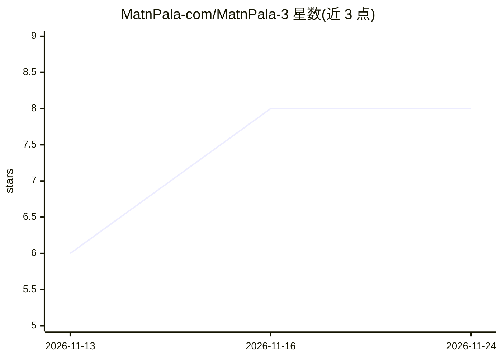

# MatnPala-com/MatnPala-3

⭐ 8 · PHP · GPL-3.0 · 推送 2026-11-15 · [GitHub](https://github.com/MatnPala-com/MatnPala-3) · 个人维护

**波斯语文本的离线 NLP 摘要引擎（PHP 实现）**

零依赖的波斯语（Farsi）NLP 引擎，完全离线运行于自有基础设施，不依赖外部 API。采用统计加权与启发式规则结合的多层流水线：文档类型分类器自动识别领域（哲学/学术/新闻等）并调整权重，内置 BM25、余弦相似度、位置先验打分，配合波斯语分词与字符归一化、共指消解、MMR 去冗余和论辩挖掘以保留逻辑结构。要求 PHP >= 8.0 及 pdo_sqlite、mbstring、curl 扩展，通过 git clone 获取源码后经 Web 服务器或 CLI 运行。自评指标为启发式诊断而非人工金标准。

## 筛选速览

| 维度 | 判定 | 备注 |
|---|---|---|
| AI 角色 | `ai-native` | 本体是模型或模型工具 |
| 许可风险 | `viral` | GPL-3.0 |
| 部署形态 | `None` |  |
| 模型依赖 | — | README 未给出锁定关系 |
| 硬件要求 | — | 无带数字的原话,不猜 |
| 安装摩擦 | `low` | 无编译、无系统依赖或容器化 |
| 成熟度 | — | 结构信号不足 |

## 能力要点

- DocType 分类器按检测到的文档类型动态调整加权矩阵
- BM25、余弦相似度与位置先验的统计句子打分
- 波斯语原生分词/词干化与阿拉伯-波斯字符归一化
- 共指消解、MMR 去冗余与论辩挖掘（论点/前提/结论）

## 适用场景

- 对波斯语长文档生成摘要且不将文本发送到外部 API
- 处理哲学、学术、新闻等不同领域的波斯语文章
- 在自有服务器上部署离线波斯语文本分析流水线

## 场景标签

`AI 写作` `文档解析` · 领域:内容生成

## 证据(README 行号)

> L10:  An independent, zero-dependency NLP engine designed for deep semantic understanding and high-fidelity summarizatio
> L18: The engine utilizes a hybrid, multi-layered pipeline that combines statistical weighting with heuristic rules to pr

## 星数曲线

2026-11-13 6 → 2026-11-24 8（+2）

---
*卡片 v1 · prompt 1.4 · 生成 2026-11-20 · 置信度 high · 依据 README sha `074ac4444f38` · [字段定义](../../DATASET.md)*
