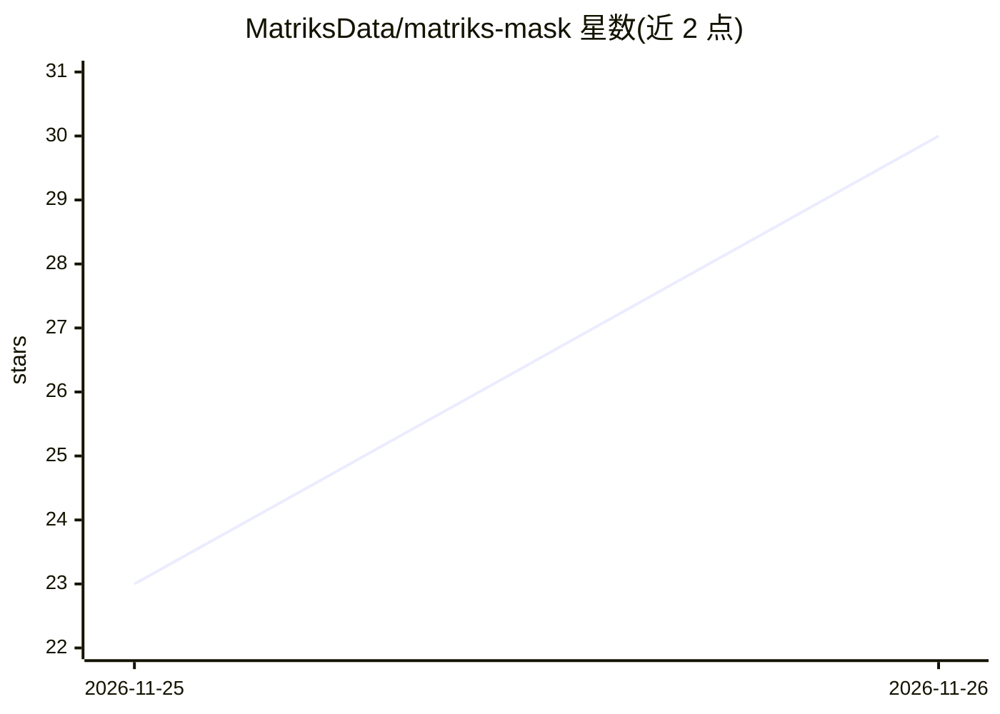

# MatriksData/matriks-mask

⭐ 30 · Python · Apache-2.0 · 推送 2026-11-23 · [GitHub](https://github.com/MatriksData/matriks-mask) · 组织维护

**土耳其文本 PII 可逆脱敏 LiteLLM 防护栏，支持 KVKK 合规**

作为 LiteLLM 代理的 guardrail 插件：请求到达 LLM 提供商前，将土耳其身份证号（TCKN）、税号、IBAN、卡号、电话、姓名、地址、API 密钥及 KVKK 第 6 条特殊类别数据替换为占位符，响应返回时（含流式）将占位符还原为原值，原文不会进入代理日志或审计记录。检测全部进程内完成，不向外部服务发送文本。可脱离 LiteLLM 以 CLI 或 Python 库单独使用。README 明确声明其不构成法律意见，且不保证检测到全部个人数据。

## 筛选速览

| 维度 | 判定 | 备注 |
|---|---|---|
| AI 角色 | `ai-ecosystem` | LLM/agent 周边工具 |
| 许可风险 | `permissive` | Apache-2.0 |
| 部署形态 | `self-host` | docker 或自建部署 |
| 模型依赖 | — | README 未给出锁定关系 |
| 硬件要求 | — | 无带数字的原话,不猜 |
| 安装摩擦 | `low` | 无编译、无系统依赖或容器化 |
| 成熟度 | — | 结构信号不足 |

## 能力要点

- 可逆脱敏：请求中占位符替换、响应中还原（含流式，带土耳其语后缀元音和谐修复）
- 土耳其专属标识符检测：TCKN/VKN/IBAN/Troy 卡/车牌等，含校验位验证
- KVKK 第 6 条特殊类别数据：12 类，仅在与个人关联时脱敏
- 组织自定义规则：extra_regex/deny_list/allow_list，无需改代码

## 适用场景

- 土耳其语 LLM 应用中防止个人数据发送给模型提供商
- 企业按 KVKK 要求对 LLM 请求做 PII 脱敏处理
- 在 CI 中用 selftest 验证脱敏配置
- 用 CLI 或 Python 库对文本做独立脱敏还原

## 场景标签

 · 领域:LLM 基础设施/隐私合规

## 证据(README 行号)

> L10: Reversible personal data (PII) masking for Turkish text, built as a LiteLLM
> L88: Minimum LiteLLM version is **1.106.1** (tested with 1.106.1, 1.106.5 and 1.110.2). LiteLLM `config.yaml`:

## 星数曲线

2026-11-25 23 → 2026-11-26 30（+7）

---
*卡片 v1 · prompt 1.4 · 生成 2026-11-25 · 置信度 mid · 依据 README sha `ef804d5e371b` · [字段定义](../../DATASET.md)*
