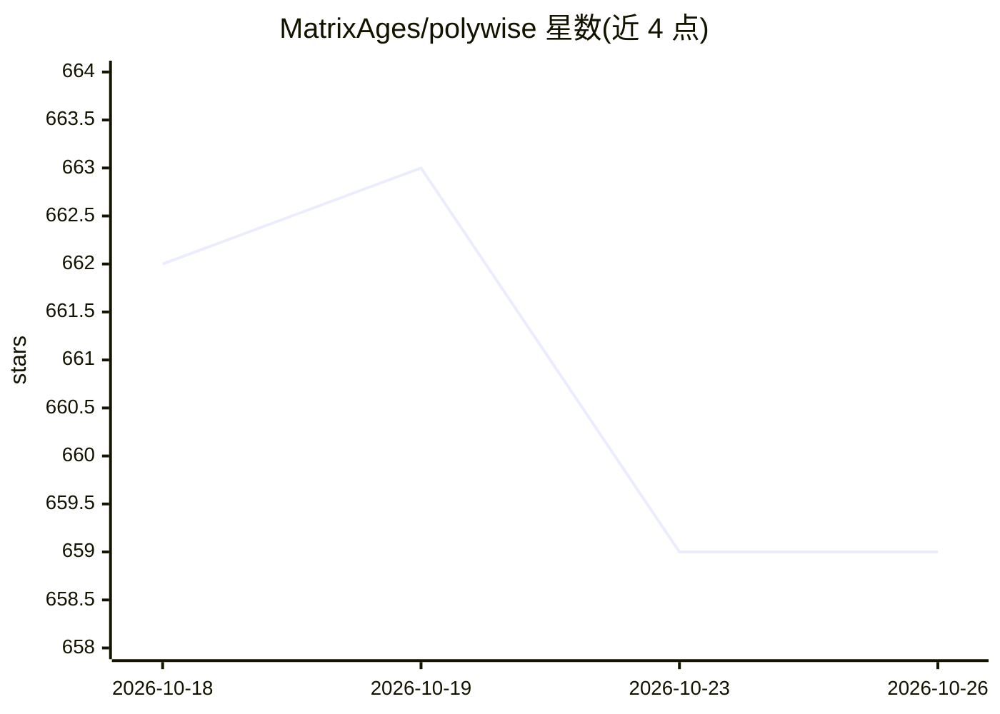

# MatrixAges/polywise

⭐ 659 · TypeScript · MIT · 推送 2026-06-11 · [GitHub](https://github.com/MatrixAges/polywise) · [官网](https://polywise.io) · 组织维护 · 中文 README

**开源 agentic 内容系统：对话、知识保存与检索、可复用 agent**

自托管的 agentic 内容系统，提供 CLI 与桌面应用两种入口。用户可连接模型供应商进行对话，将笔记、网页摘要、回答保存为知识条目，在会话中通过 @ 引入文件与 agent、通过 / 引入工具技能，并把重复的工作方式固化为可复用 agent。检索依赖 embedding 与 rerank 模型，底层使用 Sqlite 与 sqlite-vec。CLI 默认与 localhost:3072 的后端服务通信，Web UI 支持开启密码认证以便远程部署。

## 筛选速览

| 维度 | 判定 | 备注 |
|---|---|---|
| AI 角色 | `ai-native` | 本体是模型或模型工具 |
| 许可风险 | `permissive` | MIT |
| 部署形态 | `library` | 以包/库形式分发 |
| 模型依赖 | — | README 未给出锁定关系 |
| 硬件要求 | — | 无带数字的原话,不猜 |
| 安装摩擦 | `low` | 无编译、无系统依赖或容器化 |
| 成熟度 | — | 结构信号不足 |

## 能力要点

- CLI 与桌面应用双入口，Web UI 支持密码认证
- 知识保存与会话内检索（需配置 embedding 与 rerank 模型）
- @ 引入文件/agent 上下文，/ 引入工具与技能
- Linkcase 抓取并提取网页内容入系统

## 适用场景

- 把日常对话、笔记与网页内容沉淀为可检索的个人知识库
- 将重复的工作指令固化为可复用的 agent
- 在服务器上自托管并通过 Web UI 远程使用

## 场景标签

`AI 助手` `知识库管理` `网页抓取` · 领域:效率与自动化

## 证据(README 行号)

> L38: Polywise is the open-source agentic content system. You can use it from the command line or the desktop app to chat
> L96: 1. Open `Settings -> Model Provider` and configure one provider you can actually use.

## 星数曲线

2026-10-18 662 → 2026-10-26 659（-3）

---
*卡片 v1 · prompt 1.4 · 生成 2026-10-21 · 置信度 high · 依据 README sha `747e726ce7c0` · [字段定义](../../DATASET.md)*
