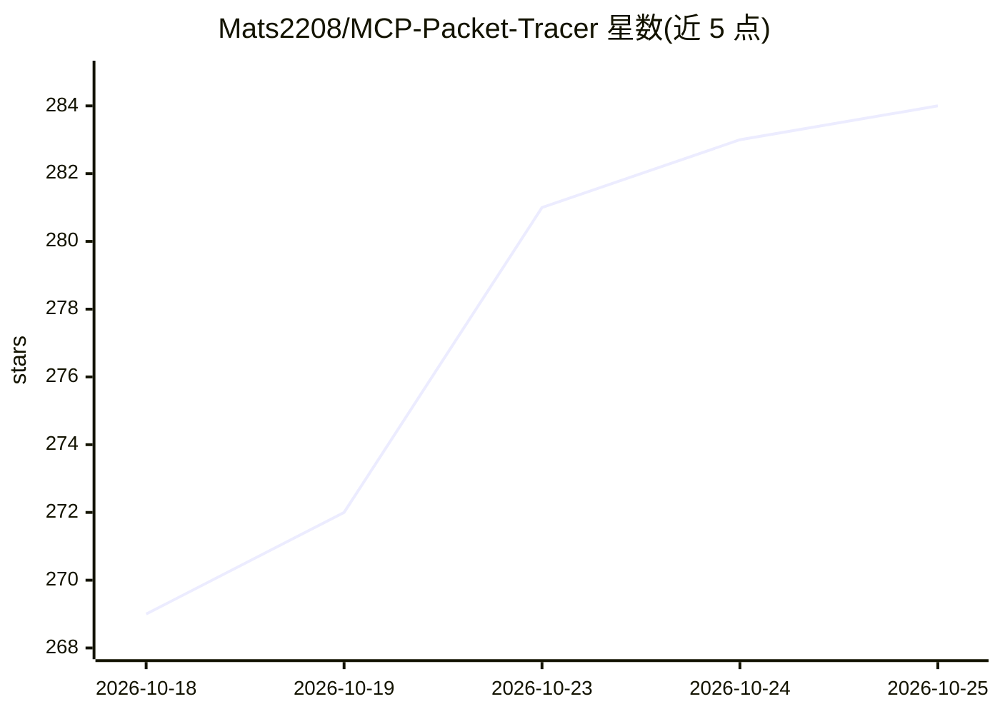

# Mats2208/MCP-Packet-Tracer

⭐ 287 · Python · MIT · 推送 2026-10-15 · [GitHub](https://github.com/Mats2208/MCP-Packet-Tracer) · [官网](https://www.mcpnetwork.top/) · 个人维护

**让 LLM 通过自然语言自动构建和部署 Packet Tracer 网络拓扑的 MCP 服务器**

一个 Model Context Protocol（MCP）服务器，向任意 LLM 客户端（Claude Code、Cursor、VS Code Copilot 等）开放 79 个工具，对 Cisco Packet Tracer 进行程序化控制：自然语言生成拓扑计划，自动分配 IP/DHCP、生成 Static/OSPF/EIGRP/RIP 的 IOS 配置，并通过 HTTP 或文件桥接实时部署到运行中的 Packet Tracer；另提供设备 CLI/面板操作、连通性验证、安全审计、配置备份与 .pkt 项目保存。需 Python 3.11+，实时部署需安装配套的 .pts 扩展（v0.6.0+ 要求 V5 版本）

## 筛选速览

| 维度 | 判定 | 备注 |
|---|---|---|
| AI 角色 | `ai-ecosystem` | LLM/agent 周边工具 |
| 许可风险 | `permissive` | MIT |
| 部署形态 | `desktop` | 安装包/桌面程序 |
| 模型依赖 | — | README 未给出锁定关系 |
| 硬件要求 | — | 无带数字的原话,不猜 |
| 安装摩擦 | `low` | 无编译、无系统依赖或容器化 |
| 成熟度 | — | 结构信号不足 |

## 能力要点

- 79 个 MCP 工具：规划、验证、部署、检查、备份全流程
- 支持 Static/OSPF/EIGRP/RIP、VLAN、ACL/NAT、IPv6 双栈、无线等配置生成
- 通过自研扩展与本地 HTTP 桥实时部署到运行中的 Packet Tracer
- 设备面板工具可操作 IOS CLI、PC 命令行与 Server 服务，默认无头模式

## 适用场景

- 用自然语言让 AI 搭建并验证 Cisco 网络拓扑
- 网络教学中自动生成实验环境并检查连通性
- 在 Claude Code / Cursor 等客户端中自动化 Packet Tracer 操作

## 场景标签

 · 领域:网络仿真/自动化

## 证据(README 行号)

> L41: A **Model Context Protocol (MCP) server** that gives any LLM (Claude, GitHub Copilot, Codex, …) full programmatic c
> L3: **Tell your AI _"create a network with 3 routers, OSPF and DHCP"_ — it plans, validates, generates, and deploys the 

## 星数曲线

2026-10-18 269 → 2026-10-25 284（+15）

---
*卡片 v1 · prompt 1.4 · 生成 2026-10-22 · 置信度 mid · 依据 README sha `14140a0705a9` · [字段定义](../../DATASET.md)*
