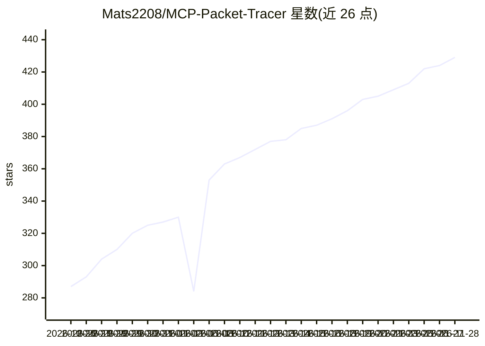

# Mats2208/MCP-Packet-Tracer

⭐ 429 · Python · MIT · 推送 2026-11-11 · [GitHub](https://github.com/Mats2208/MCP-Packet-Tracer) · [官网](https://www.mcpnetwork.top/) · 个人维护

**MCP 服务器：让 AI agent 用自然语言生成并部署 Cisco Packet Tracer 拓扑**

以 MCP 服务器形式连接 AI agent 与 Cisco Packet Tracer：提供 111 个工具、6 个资源与 3 个提示，覆盖拓扑规划、校验、自动修复、实时部署、IOS 配置生成、路由/交换/安全/语音配置、连通性验证与 .pka 考试构建与评分。需要本机安装 Packet Tracer 8.2+（Windows/macOS），通过回环桥接与按机器令牌通信；Linux 下扩展需手动添加，UI 模式仅支持 Windows。

## 筛选速览

| 维度 | 判定 | 备注 |
|---|---|---|
| AI 角色 | `ai-ecosystem` | LLM/agent 周边工具 |
| 许可风险 | `permissive` | MIT |
| 部署形态 | `library` | 以包/库形式分发 |
| 模型依赖 | — | README 未给出锁定关系 |
| 硬件要求 | — | 无带数字的原话,不猜 |
| 安装摩擦 | `low` | 无编译、无系统依赖或容器化 |
| 成熟度 | — | 结构信号不足 |

## 能力要点

- 111 个 MCP 工具：规划→校验→修复→部署→验证的完整流程
- 支持 OSPF/EIGRP/RIP/HSRP/BGP、VLAN/STP/EtherChannel、ACL/NAT/加固等 IOS 配置生成
- PKA Builder：一句话生成带评分项的 CCNA .pka 考试，可逐项评分
- 通过 Packet Tracer 官方 Extensions API 与 Activity Wizard 操作，不解析 .pka 文件格式

## 适用场景

- 用自然语言在 Packet Tracer 中搭建 OSPF/DHCP 实验拓扑并验证连通性
- CCNA 讲师批量生成不同版本的评分实验
- 学生练习自定义考题并逐项检查失分原因
- 通过 agent 读取路由表、OSPF 邻居等实时网络状态做排错

## 场景标签

`编码 Agent` `代码生成` · 领域:编码与开发

## 证据(README 行号)

> L1: Packet Tracer MCP — describe a network and watch it build itself in Cisco Packet Tracer
> L7:  Install it by asking your agent: "Install the Packet Tracer MCP from github.com/Mats2208/MCP-Packet-Tracer and set 
> L180: claude mcp add --scope user --transport stdio packet-tracer -- uvx packet-tracer-mcp --stdio

## 星数曲线

2026-10-26 287 → 2026-11-28 429（+142）

---
*卡片 v1 · prompt 1.4 · 生成 2026-11-25 · 置信度 mid · 依据 README sha `2b2d468f8200` · [字段定义](../../DATASET.md)*
