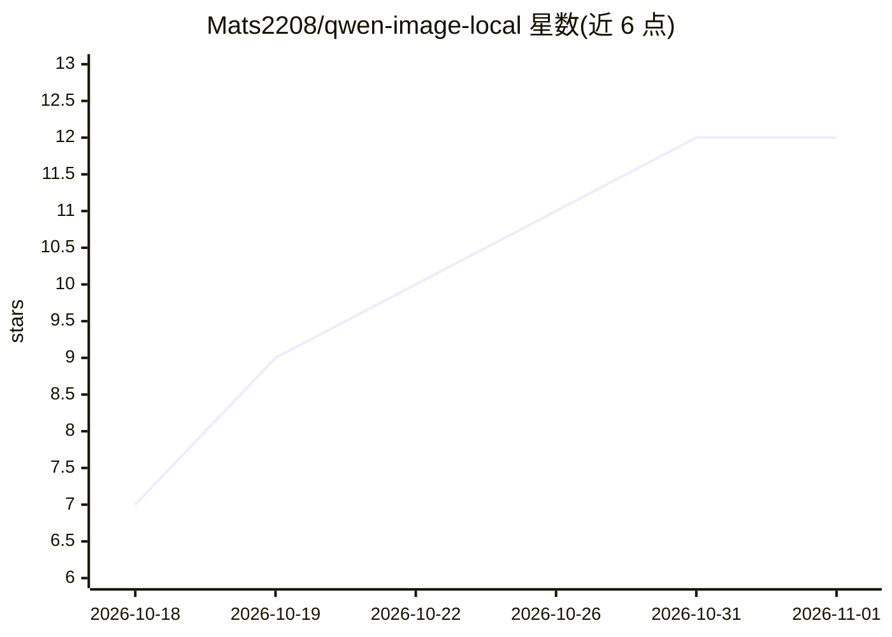

# Mats2208/qwen-image-local

⭐ 12 · Rust · NOASSERTION · 推送 2026-09-26 · [GitHub](https://github.com/Mats2208/qwen-image-local) · [官网](https://mats2208.github.io/qwen-image-local/) · 个人维护

**在小显存 GPU 上本地运行 Qwen-Image-2.1 的文生图与修图应用**

面向持有 12 GB NVIDIA 显卡用户的本地文生图与照片编辑工具：封装 Qwen-Image-2.1（7B）模型，通过一次加载一个阶段（文本编码器/图像模型/VAE 分别完整载入 VRAM、其余驻留内存）的方式将显存峰值压至约 11.4 GB。提供 Tauri 桌面应用与 qil CLI（doctor/setup/generate/edit/surprise/bench/config），首次运行自动安装固定版 ComfyUI、Python 3.12、CUDA 13 版 PyTorch 并下载权重（SHA-256 校验、断点续传）。生成约 35 s/1024² 图像；支持 1–10 张参考图编辑、原生 RGBA 透明通道。限制：仅支持 Windows + NVIDIA，权重为非商业许可；附对 gpt-image-2 的 20 项公开对比测试（文生图多负、照片编辑持平）。

## 筛选速览

| 维度 | 判定 | 备注 |
|---|---|---|
| AI 角色 | `ai-native` | 本体是模型或模型工具 |
| 许可风险 | `none` | NOASSERTION |
| 部署形态 | `desktop` | 安装包/桌面程序 |
| 模型依赖 | — | README 未给出锁定关系 |
| 硬件要求 | `gpu-8g` | |
| 安装摩擦 | `high` | 编译与系统依赖俱全 |
| 成熟度 | `idea` | |

## 能力要点

- 12 GB VRAM 逐阶段完整加载策略，RTX 3060 上约 35 s 生成 1024² 图像
- 桌面应用 + qil CLI，一键安装 ComfyUI/Python/PyTorch/权重并复用已有模型目录
- 支持 1–10 张参考图的照片编辑与原生 RGBA 透明输出
- 发布 20 项对 gpt-image-2 的公开基准（含全部图像与判定）

## 适用场景

- 我用 12 GB 显卡想离线生成和编辑图片，不想上传照片
- 在本地重绘照片中的文字、移除物体或抠出透明背景
- 小显存用户跑基准并了解自己显卡能跑什么模型

## 场景标签

`图像生成` · 领域:内容生成

## 证据(README 行号)

> L1: qwen-image-local — run Qwen-Image-2.1 text-to-image and photo editing on a 12 GB NVIDIA GPU. This banner was generat
> L20: Qwen-Image-2.1 came out on September 20, 2026. It is the first open-weight image model that is genuinely good **and

## 星数曲线

2026-10-18 7 → 2026-11-01 12（+5）

---
*卡片 v1 · prompt 1.4 · 生成 2026-11-01 · 置信度 mid · 依据 README sha `a71bb0cd360b` · [字段定义](../../DATASET.md)*
