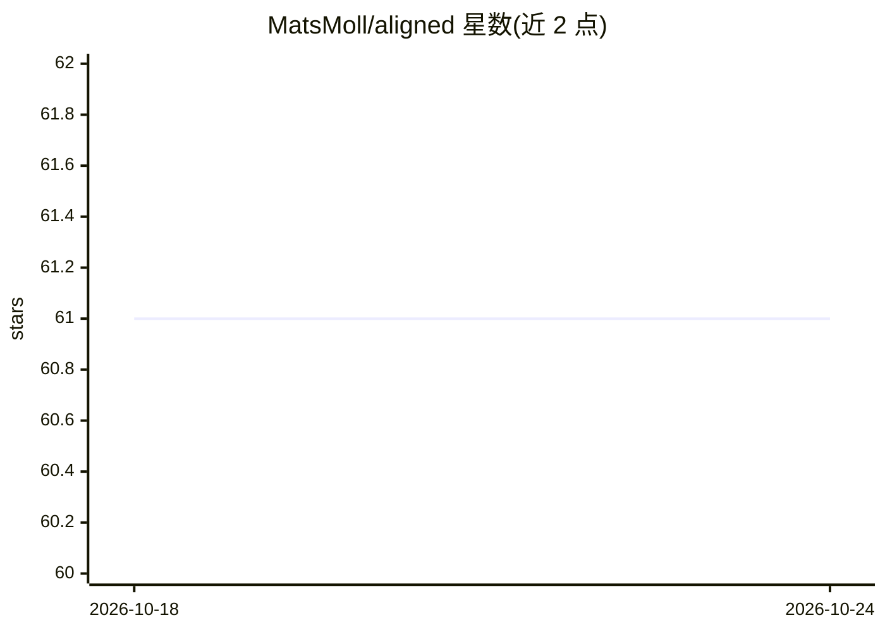

# MatsMoll/aligned

⭐ 61 · Python · NOASSERTION · 推送 2026-07-16 · [GitHub](https://github.com/MatsMoll/aligned) · [官网](https://www.aligned.codes) · 个人维护

**面向 ML 的数据/模型契约管理工具，降低数据债**

定位为『ML 界的 DBT』的 Python 数据管理工具：通过 data_contract 与 model_contract 两个核心概念描述 ML 系统中的数据依赖，回答预测什么、预测存哪、依赖哪些模型、真值在哪等问题。提供数据目录、数据血缘、数据新鲜度、质量校验、特征存取与模型暴露（MLFlow Server、Ollama endpoint 等），支持本地/AWS S3/Azure Blob 数据源，可用 SQL 查询数据湖。UI 与文档仍在开发中，项目处于活跃开发期，接口可能变动。

## 筛选速览

| 维度 | 判定 | 备注 |
|---|---|---|
| AI 角色 | `ai-ecosystem` | LLM/agent 周边工具 |
| 许可风险 | `none` | NOASSERTION |
| 部署形态 | `None` |  |
| 模型依赖 | local-ok | 支持本地模型 |
| 硬件要求 | — | 无带数字的原话,不猜 |
| 安装摩擦 | `low` | 无编译、无系统依赖或容器化 |
| 成熟度 | `idea` | |

## 能力要点

- data_contract / model_contract 代码化定义数据与模型依赖
- 数据目录、血缘、新鲜度检查与质量约束校验（drop_invalid）
- 多种模型暴露实现：MLFlow Server、Ollama completion/embedded endpoint 等
- 支持 local / AWS S3 / Azure Blob 数据源切换与 point-in-time 有效数据

## 适用场景

- ML 团队用契约统一管理特征与模型依赖，减少数据债
- 通过契约定义直接加载模型特征或批量获取预测
- 校验数据新鲜度与质量约束，过滤不合规记录

## 场景标签

`MLOps` · 领域:训练与推理

## 证据(README 行号)

> L5: Similar to how DBT is a data management tool for business analytics, will Aligned manage ML projects.
> L53: - Feature Store
> L141: Aligned mainly focuses on defining the expected input and output of different models. However, this in itself make

## 星数曲线

2026-10-18 61 → 2026-10-24 61（+0）

---
*卡片 v1 · prompt 1.4 · 生成 2026-10-24 · 置信度 high · 依据 README sha `ddd7a24c594e` · [字段定义](../../DATASET.md)*
