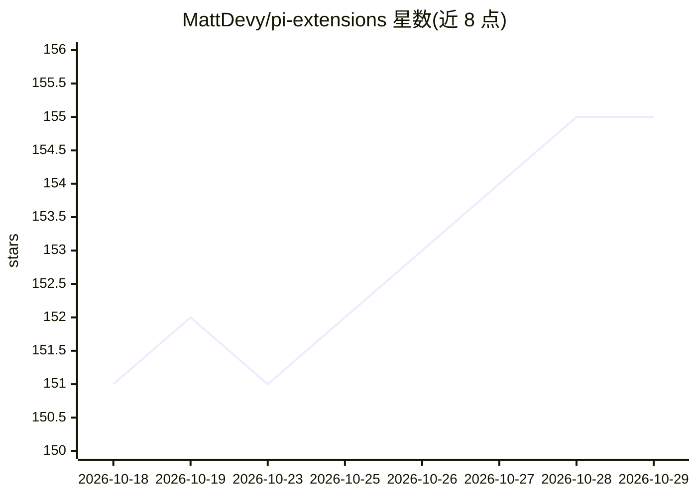

# MattDevy/pi-extensions

⭐ 155 · TypeScript · MIT · 推送 2026-10-18 · [GitHub](https://github.com/MattDevy/pi-extensions) · [官网](https://mattdevy.github.io/home) · 个人维护

**Pi 编码代理扩展合集：持续学习、TDD、代码评审等**

TypeScript monorepo，收录 6 个面向 Pi 编码代理的扩展包，独立发布于 packages/ 下：pi-continuous-learning 观察编码会话并将模式提炼为带置信度评分的可复用 instincts（闭环反馈）；pi-red-green 以 RED-GREEN-REFACTOR 状态机做 TDD 强制；pi-compass 生成代码地图与导览；pi-simplify 审查近期改动文件的清晰度；pi-code-review 提供语言感知的自动评审；pi-blueprint 做多会话分阶段规划。面向使用 Pi 代理的开发者，经 npm 安装各包。

## 筛选速览

| 维度 | 判定 | 备注 |
|---|---|---|
| AI 角色 | `ai-ecosystem` | LLM/agent 周边工具 |
| 许可风险 | `permissive` | MIT |
| 部署形态 | `library` | 以包/库形式分发 |
| 模型依赖 | — | README 未给出锁定关系 |
| 硬件要求 | — | 无带数字的原话,不猜 |
| 安装摩擦 | `low` | 无编译、无系统依赖或容器化 |
| 成熟度 | — | 结构信号不足 |

## 能力要点

- pi-continuous-learning：观察会话提炼模式为带置信度的 instincts，闭环反馈
- pi-red-green：RED-GREEN-REFACTOR 状态机 TDD 强制与阶段化提示注入
- pi-compass：生成结构化 codemap 与交互式代码导览
- pi-blueprint：目标转化为带依赖追踪与验证关卡的分阶段计划

## 适用场景

- 让 Pi 编码代理从历史会话中积累可复用经验
- 在代理会话中强制执行 TDD 流程
- 新成员或新会话快速熟悉代码库结构

## 场景标签

`编码 Agent` `代码审查` `Agent 记忆` · 领域:Agent 开发

## 证据(README 行号)

> L6: A monorepo of Pi extensions, built and released independently under `packages/`.
> L12: |pi-continuous-learning|Observes coding sessions and distils patterns into reusable instincts with confidence scori

## 星数曲线

2026-10-18 151 → 2026-10-29 155（+4）

---
*卡片 v1 · prompt 1.4 · 生成 2026-10-22 · 置信度 mid · 依据 README sha `0d244083956a` · [字段定义](../../DATASET.md)*
