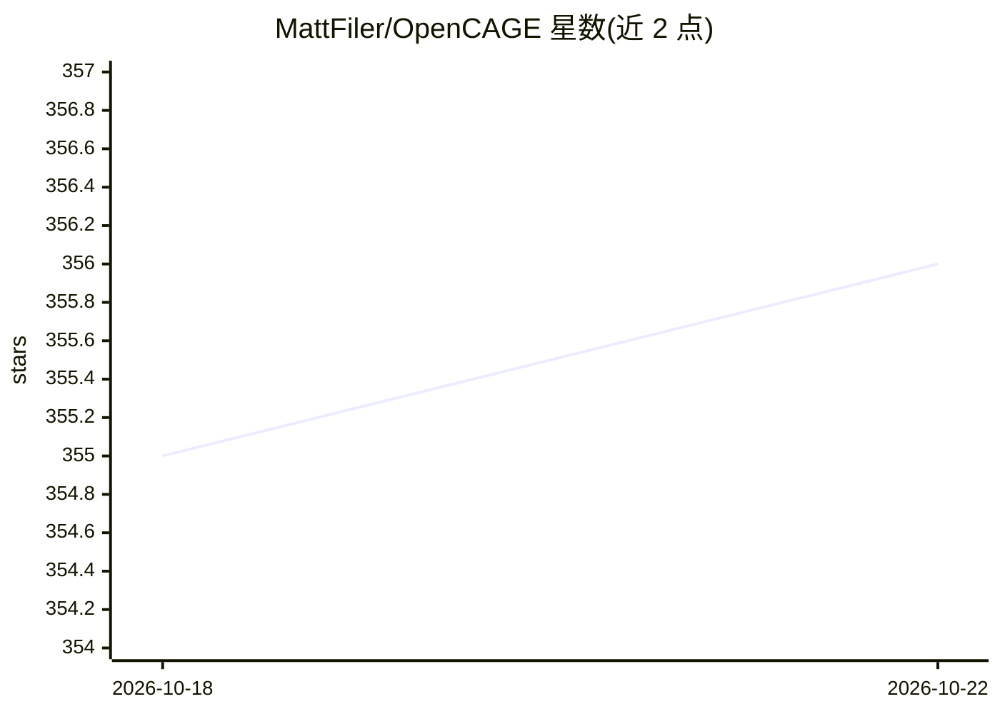

# MattFiler/OpenCAGE

⭐ 356 · C# · MIT · 推送 2026-10-21 · [GitHub](https://github.com/MattFiler/OpenCAGE) · [官网](http://opencage.co.uk) · 个人维护

**《异形：隔离》开源模组工具箱：改脚本/配置/资产/行为树**

面向《Alien: Isolation》玩家与模组作者的免费开源模组工具箱，通过 Steam 下载。首次启动需定位游戏 AI.exe，之后可载入关卡、浏览并修改脚本（Composites）、编辑角色与物品配置、编辑行为树以及模型/纹理/材质等资产，支持全局或按关卡修改，并提供启动游戏与备份管理功能。工具本身不含 AI 功能，行为树编辑针对游戏 AI 逻辑的模组修改。需已购买并安装原游戏。

## 筛选速览

| 维度 | 判定 | 备注 |
|---|---|---|
| AI 角色 | `ai-enhanced` | 去掉 AI 部分产品仍成立 |
| 许可风险 | `permissive` | MIT |
| 部署形态 | `desktop` | 安装包/桌面程序 |
| 模型依赖 | — | README 未给出锁定关系 |
| 硬件要求 | — | 无带数字的原话,不猜 |
| 安装摩擦 | `low` | 无编译、无系统依赖或容器化 |
| 成熟度 | — | 结构信号不足 |

## 能力要点

- 图形界面浏览与修改关卡脚本（Composites）逻辑
- 行为树编辑器（基于 Brainiac Designer 库）
- 模型/纹理/材质等资产的关卡级与全局编辑
- 工具栏内直接启动游戏与备份管理

## 适用场景

- 给《异形：隔离》做自定义脚本与配置修改的模组
- 编辑游戏 AI 行为树调整敌人/角色行为
- 替换或修改模型、纹理、材质等游戏资产

## 场景标签

 · 领域:游戏/模组工具

## 证据(README 行号)

> L15: Once the toolkit has set itself up you will be prompted to load a level into the editor. After loading you can brow
> L47:  OpenCAGE is in no way related to (or endorsed by) Creative Assembly or SEGA. Alien: Isolation must be purchased an

## 星数曲线

2026-10-18 355 → 2026-10-22 356（+1）

---
*卡片 v1 · prompt 1.4 · 生成 2026-10-21 · 置信度 low · 依据 README sha `f2d9021542e4` · [字段定义](../../DATASET.md)*
