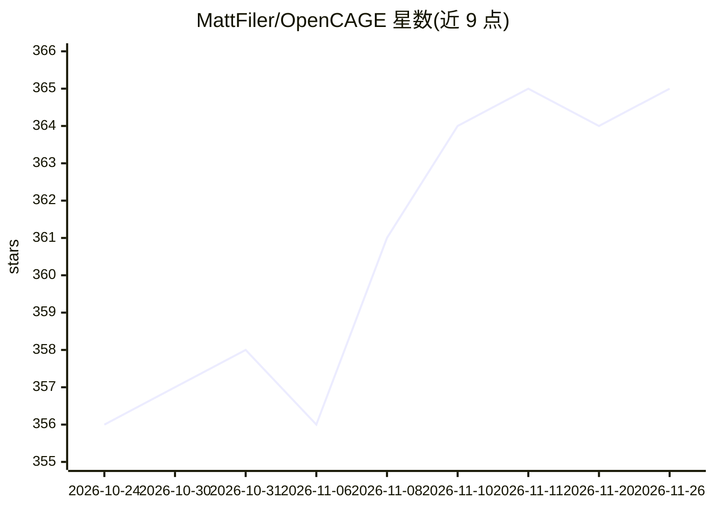

# MattFiler/OpenCAGE

⭐ 365 · C# · MIT · 推送 2026-11-24 · [GitHub](https://github.com/MattFiler/OpenCAGE) · [官网](http://opencage.co.uk) · 个人维护

**《异形：隔离》的开源 Mod 制作工具包**

OpenCAGE 是面向 Alien: Isolation 的开源 Mod 工具包，提供 3D 关卡编辑视口、CATHODE 脚本流程图编辑与运行时调试（Live Link、断点、断点步进）、动画曲线与动画树编辑、模型/材质/纹理导入导出、从零构建新关卡并生成光照/导航网格/碰撞、电影镜头拍摄，以及行为树节点级编辑（驱动异形、仿生人与人类的 AI）。通过 Steam 免费分发，需自行购买并安装游戏本体，与 Creative Assembly/SEGA 无关联。

## 筛选速览

| 维度 | 判定 | 备注 |
|---|---|---|
| AI 角色 | `ai-enhanced` | 去掉 AI 部分产品仍成立 |
| 许可风险 | `permissive` | MIT |
| 部署形态 | `None` |  |
| 模型依赖 | — | README 未给出锁定关系 |
| 硬件要求 | — | 无带数字的原话,不猜 |
| 安装摩擦 | `low` | 无编译、无系统依赖或容器化 |
| 成熟度 | — | 结构信号不足 |

## 能力要点

- 编辑游戏内 CATHED 脚本流程图并支持 Live Link 运行时调试
- 可节点级编辑驱动异形/仿生人/人类的行为树
- 从零创建新关卡，Save and Build 生成光照、导航网格、碰撞与声音
- Mod Manager 打包、安装、合并与更新 Mod

## 适用场景

- 为 Alien: Isolation 制作新关卡、任务或模式
- 修改异形的行为树与游戏配置
- 导入自定义模型和纹理制作 Mod
- 用电影镜头工具拍摄游戏内画面

## 场景标签

 · 领域:游戏/Mod 工具

## 证据(README 行号)

> L7:  OpenCAGE is an extensive open-source modding toolkit for Alien: Isolation which unlocks the ability to fully custom
> L117:  Edit and Create Behaviour Trees
> L121:  OpenCAGE is a hobby project and is not affiliated with Creative Assembly, SEGA, or Feral Interactive.

## 星数曲线

2026-10-24 356 → 2026-11-26 365（+9）

---
*卡片 v1 · prompt 1.4 · 生成 2026-11-25 · 置信度 high · 依据 README sha `28a695b26af1` · [字段定义](../../DATASET.md)*
