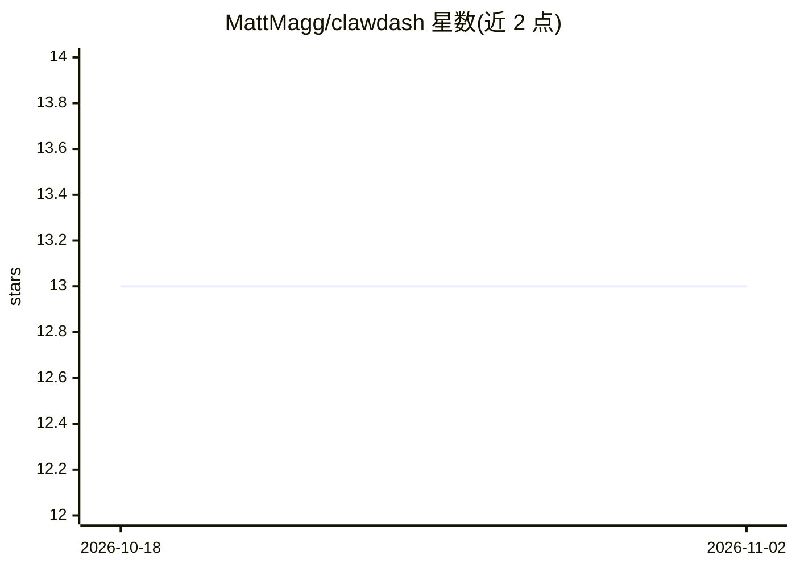

# MattMagg/clawdash

⭐ 13 · TypeScript · MIT · 推送 2026-05-23 · [GitHub](https://github.com/MattMagg/clawdash) · [官网](https://github.com/openclaw) · 个人维护

**OpenClaw 的实时控制面板：监控与管理 AI agent 与网关**

面向 OpenClaw 网关的 Web 控制平面：通过 WebSocket（OpenClaw Protocol v3）连接网关，提供实时仪表盘（健康卡片、拓扑图、活动会话）、会话工作区（聊天记录、配置、编排面板）、Agent 管理与 Cron 任务调度、可过滤的活动流、系统控制台（配置编辑器、模型浏览器、执行审批）。技术栈为 Next.js 16 + React 19 + tRPC v11，git clone 后 npm 安装并配置环境变量运行。需 Node.js v20+ 与本地运行的 OpenClaw 网关。

## 筛选速览

| 维度 | 判定 | 备注 |
|---|---|---|
| AI 角色 | `ai-ecosystem` | LLM/agent 周边工具 |
| 许可风险 | `permissive` | MIT |
| 部署形态 | `library` | 以包/库形式分发 |
| 模型依赖 | — | README 未给出锁定关系 |
| 硬件要求 | — | 无带数字的原话,不猜 |
| 安装摩擦 | `low` | 无编译、无系统依赖或容器化 |
| 成熟度 | — | 结构信号不足 |

## 能力要点

- 实时仪表盘含拓扑图、健康卡片与活动会话
- Cron 任务状态网格、调度时间线与一键执行
- 系统控制台含配置编辑器、模型浏览器、执行审批
- 通过 WebSocket 连接 OpenClaw 网关（Protocol v3）

## 适用场景

- 在一个界面集中监控 OpenClaw 的 agent 与网关状态
- 查看会话聊天记录并编排 agent 执行
- 管理定时任务并审批执行请求

## 场景标签

`LLM 可观测性` · 领域:评测与运维

## 证据(README 行号)

> L3: The real-time control plane for OpenClaw. Monitor, manage, and configure your AI agents and gateway from a single da
> L16: - **Agent Management** — View and control all registered agents
> L19: - **System Console** — Config editor, model browser, channel inspector, skills, exec approvals, and diagnostics

## 星数曲线

2026-10-18 13 → 2026-11-02 13（+0）

---
*卡片 v1 · prompt 1.4 · 生成 2026-11-01 · 置信度 high · 依据 README sha `a12458347a7b` · [字段定义](../../DATASET.md)*
