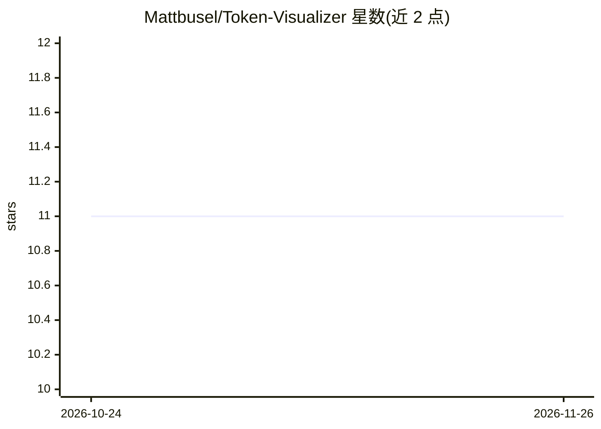

# Mattbusel/Token-Visualizer

⭐ 11 · Python · MIT · 推送 2026-11-08 · [GitHub](https://github.com/Mattbusel/Token-Visualizer) · [官网](https://mattbusel.github.io/Token-Visualizer/) · 个人维护

**给 prompt 编写者的免费 token 计数 CLI，标出可删减内容**

以 CLI 形式提供的 token 计数工具：读取标准输入的 prompt 文本，用 OpenAI 官方 tokenizer 计算总数，按行列出 token 占用最高的内容，并给出短语与空白修正后的可节省量与百分比。支持设置预算上限，超出时使 CI 失败。除命令行外，还提供 Windows .exe 与浏览器版本，MIT 许可。

## 筛选速览

| 维度 | 判定 | 备注 |
|---|---|---|
| AI 角色 | `ai-ecosystem` | LLM/agent 周边工具 |
| 许可风险 | `permissive` | MIT |
| 部署形态 | `desktop` | 安装包/桌面程序 |
| 模型依赖 | — | README 未给出锁定关系 |
| 硬件要求 | — | 无带数字的原话,不猜 |
| 安装摩擦 | `low` | 无编译、无系统依赖或容器化 |
| 成熟度 | — | 结构信号不足 |

## 能力要点

- 使用 OpenAI 官方 tokenizer 计算 token 数
- 按行显示成本最高的内容，量化可节省的 token（如 14→8，-43%）
- 预算超限时使 CI 失败
- 提供 CLI、Windows .exe 与浏览器三种使用形式

## 适用场景

- 发送 prompt 前检查 token 占用并删减冗余表述
- 在 CI 中对 prompt 文件做 token 预算校验
- 估算 LLM 调用成本时统计 token 用量

## 场景标签

`提示工程` · 领域:Agent 开发

## 证据(README 行号)

> L5: Free token counter. Shows what to cut from your prompt.
> L9: - Counts tokens with OpenAI's real tokenizers
> L12: - Fails CI when a prompt goes over budget

## 星数曲线

2026-10-24 11 → 2026-11-26 11（+0）

---
*卡片 v1 · prompt 1.4 · 生成 2026-11-19 · 置信度 mid · 依据 README sha `601ce26ea7b1` · [字段定义](../../DATASET.md)*
