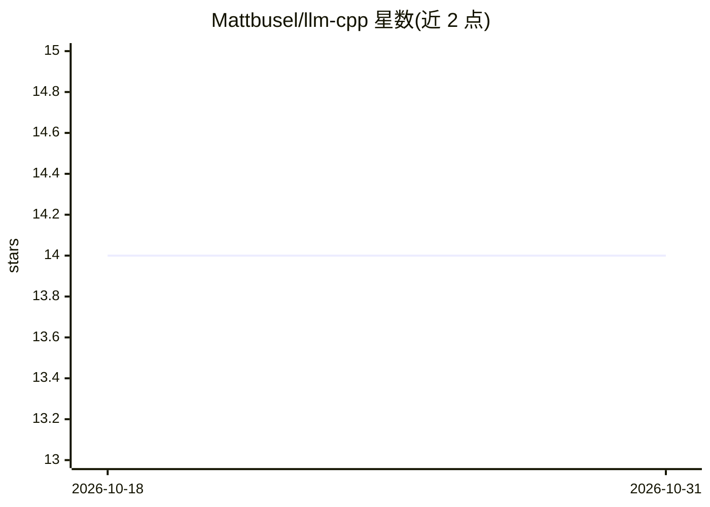

# Mattbusel/llm-cpp

⭐ 14 · HTML · MIT · 推送 2026-10-23 · [GitHub](https://github.com/Mattbusel/llm-cpp) · [官网](https://mattbusel.github.io/llm-cpp/) · 个人维护 · 中文 README

**单头文件 C++17 库集：在 C++ 应用中接入 OpenAI/Anthropic LLM 功能**

由 26 个单头 C++17 库组成的集合，面向需要在 C++ 程序中直接调用 OpenAI 与 Anthropic API 的开发者：覆盖流式输出、重试、缓存、成本估算、RAG、结构化 JSON、工具调用 agent、PII 清洗等任务。每库为自包含 .hpp，stb 风格宏开关，无需 SDK 或包管理器；离线类头文件仅依赖 C++ 标准库，联网类需 libcurl。提供 zip 下载、六个离线示例与 CI 校验输出，以 MIT 许可发布。

## 筛选速览

| 维度 | 判定 | 备注 |
|---|---|---|
| AI 角色 | `ai-ecosystem` | LLM/agent 周边工具 |
| 许可风险 | `permissive` | MIT |
| 部署形态 | `desktop` | 安装包/桌面程序 |
| 模型依赖 | locked-api |  |
| 硬件要求 | — | 无带数字的原话,不猜 |
| 安装摩擦 | `medium` | 含编译或系统依赖之一 |
| 成熟度 | — | 结构信号不足 |

## 能力要点

- 26 个单头 C++17 库，宏开关单 .cpp 实现的 stb 风格
- 覆盖流式/重试/缓存/成本估算/RAG/JSON/工具调用 agent 等 16 类任务
- 离线示例无需 API key，CI 在每次推送时重建并校验输出
- 在线头文件仅需 libcurl，其余仅依赖 C++ 标准库

## 适用场景

- 在游戏、桌面应用或交易系统中加入 LLM 调用而无需 Python 侧车
- 为 prompt 做 PII 与 API key 清洗后再发送
- 离线构建与测试 LLM 相关代码（llm_mock、无需 API key 的示例）

## 场景标签

`模型网关` · 领域:Agent 开发

## 证据(README 行号)

> L13: **Add ChatGPT or Claude features to a C++ program by copying one file.** Streaming, retries, caching, cost estimate
> L15: **Who it's for:** C++ developers shipping a game, desktop app, trading system, embedded tool or service who want LL
> L42: Green headers use only the C++ standard library. Orange ones call the OpenAI or Anthropic API and need libcurl. All

## 星数曲线

2026-10-18 14 → 2026-10-31 14（+0）

---
*卡片 v1 · prompt 1.4 · 生成 2026-10-31 · 置信度 high · 依据 README sha `afa051b71887` · [字段定义](../../DATASET.md)*
