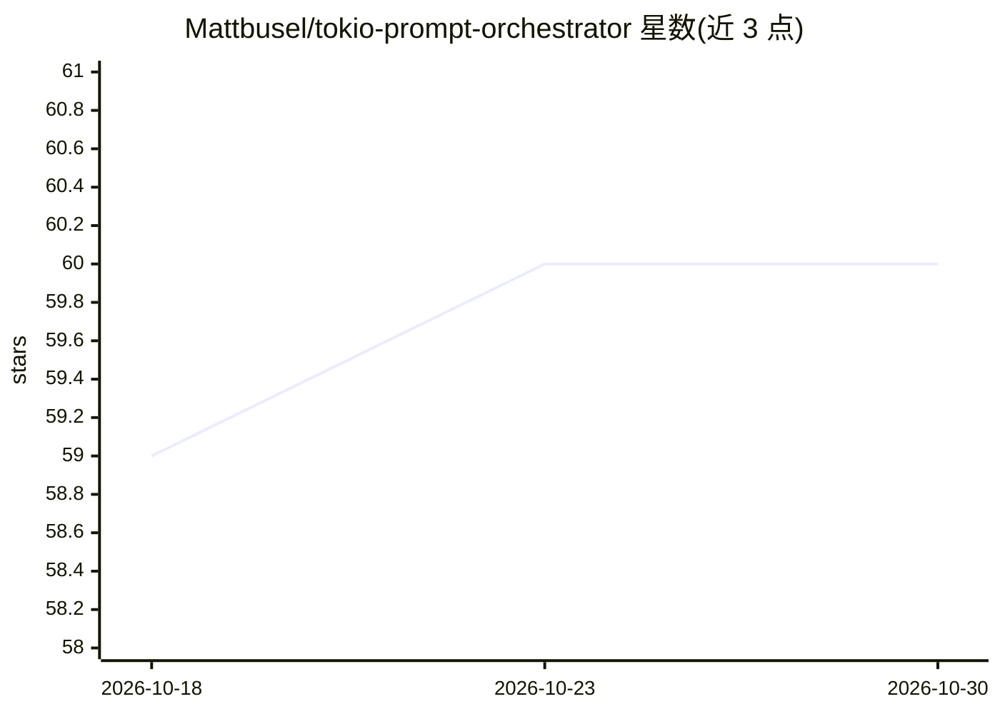

# Mattbusel/tokio-prompt-orchestrator

⭐ 60 · Rust · MIT · 推送 2026-10-23 · [GitHub](https://github.com/Mattbusel/tokio-prompt-orchestrator) · [官网](https://mattbusel.github.io/tokio-prompt-orchestrator/) · 个人维护 · 中文 README

**Rust LLM 请求编排器：去重、熔断、重试与死信队列**

位于应用与 LLM 提供方（Anthropic、OpenAI、llama.cpp、vLLM）之间的 Tokio 五阶段流水线服务：精确与语义去重把重复 prompt 合并为一次模型调用，附带并发限制、超时、指数退避重试、熔断器（5 次失败开启、60 秒后探测）、花费上限与 1000 条死信队列。以 OpenAI/Anthropic 兼容代理形式接入，现有客户端改 base URL 即可用，无需改代码；也提供 REST、SSE、MCP、TUI 与 Rust 库形式。限制：Linux 仅提供 x86_64 二进制，macOS 需从源码安装；Anthropic 通道拒绝图像与工具块。

## 筛选速览

| 维度 | 判定 | 备注 |
|---|---|---|
| AI 角色 | `ai-ecosystem` | LLM/agent 周边工具 |
| 许可风险 | `permissive` | MIT |
| 部署形态 | `desktop` | 安装包/桌面程序 |
| 模型依赖 | local-ok | 支持本地模型 |
| 硬件要求 | — | 无带数字的原话,不猜 |
| 安装摩擦 | `low` | 无编译、无系统依赖或容器化 |
| 成熟度 | — | 结构信号不足 |

## 能力要点

- 五阶段有界 channel 流水线，重复 prompt 去重为一次模型调用
- 熔断器、退避重试、花费上限与带原因的死信队列
- OpenAI/Anthropic 客户端改 base URL 即接入，无需改代码
- 可选语义去重（本地 fastembed BGE-small）与本地文档问答（tantivy BM25）

## 适用场景

- 多 agent 并发调用 LLM 时压缩重复请求、控制 API 开销
- 提供方故障期间让请求快速失败而非堆积
- 给现有 OpenAI/Anthropic 客户端加预算上限与熔断保护

## 场景标签

`模型网关` · 领域:Agent 开发

## 证据(README 行号)

> L11: **A Rust LLM request orchestrator: it sits between your app and an AI model (Anthropic, OpenAI, llama.cpp, vLLM), s
> L13: For developers who call an LLM API from an app, an agent or a script and want it to stay fast and predictable under
> L50: Any app that already uses an OpenAI client gets deduplication, the circuit breaker, timeouts, a spend cap and the d

## 星数曲线

2026-10-18 59 → 2026-10-30 60（+1）

---
*卡片 v1 · prompt 1.4 · 生成 2026-10-24 · 置信度 mid · 依据 README sha `09a41e82495b` · [字段定义](../../DATASET.md)*
