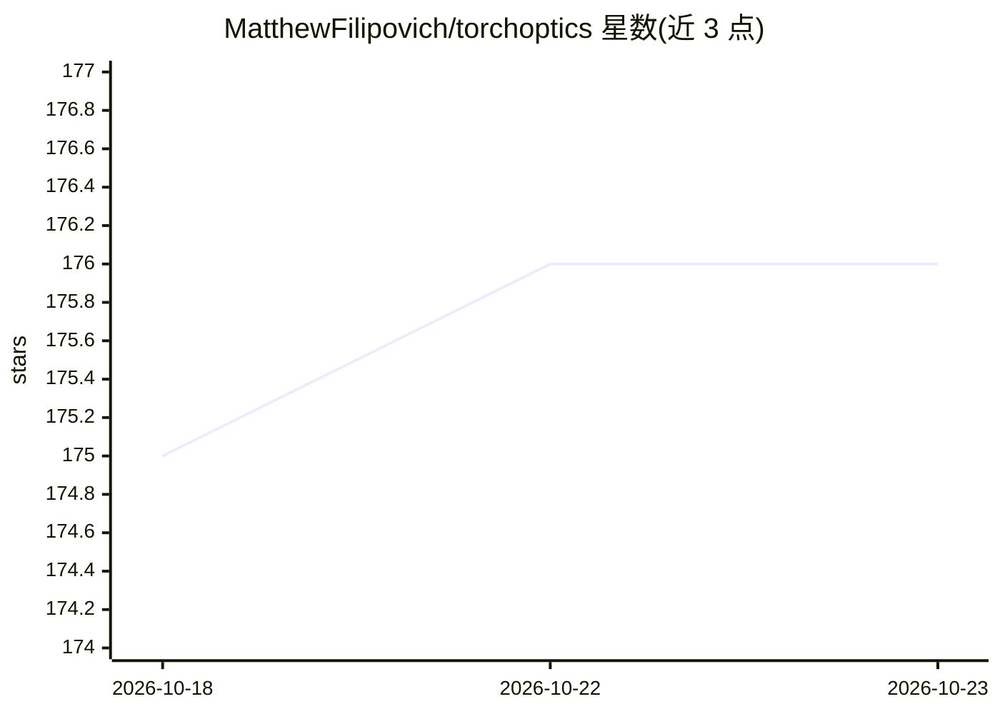

# MatthewFilipovich/torchoptics

⭐ 176 · Python · MIT · 推送 2026-05-13 · [GitHub](https://github.com/MatthewFilipovich/torchoptics) · [官网](https://torchoptics.readthedocs.io) · 个人维护

**基于 PyTorch 的可微傅里叶光学仿真库，供光学系统建模与优化**

开源 Python 库，基于 PyTorch 实现傅里叶光学范畴的波动光学仿真，支持 GPU 加速、批处理与自动微分，可对光学硬件与机器学习模型进行端到端联合优化。提供透镜、相位/振幅调制器、探测器、偏振片等光学元件，以及 Hermite-Gaussian、Laguerre-Gaussian、Zernike 模式等空间光场剖面，支持偏振与任意空间相干性仿真。面向光学研究者与开发者，附波传播、4f 成像、逆设计等示例。

## 筛选速览

| 维度 | 判定 | 备注 |
|---|---|---|
| AI 角色 | `ai-ecosystem` | LLM/agent 周边工具 |
| 许可风险 | `permissive` | MIT |
| 部署形态 | `library` | 以包/库形式分发 |
| 模型依赖 | — | README 未给出锁定关系 |
| 硬件要求 | — | 无带数字的原话,不猜 |
| 安装摩擦 | `low` | 无编译、无系统依赖或容器化 |
| 成熟度 | — | 结构信号不足 |

## 能力要点

- GPU 加速、完全可微的波动光学仿真
- 光学硬件与机器学习模型的端到端联合优化
- 涵盖透镜、调制器、探测器、偏振片等光学元件
- 支持偏振光与任意空间相干性场仿真

## 适用场景

- 仿真自由空间光传播与 4f 成像系统
- 逆设计衍射光学系统实现指定光束变换
- 光学神经网络等光计算硬件与模型联合训练

## 场景标签

 · 领域:计算光学/科学计算

## 证据(README 行号)

> L8: **TorchOptics** is an open-source Python library for simulating optical systems using Fourier optics, built on PyTor
> L16: - 🛠️ **End-to-End Optimization:** Joint optimization of optical hardware and machine learning models.

## 星数曲线

2026-10-18 175 → 2026-10-23 176（+1）

---
*卡片 v1 · prompt 1.4 · 生成 2026-10-22 · 置信度 high · 依据 README sha `7b3917560712` · [字段定义](../../DATASET.md)*
