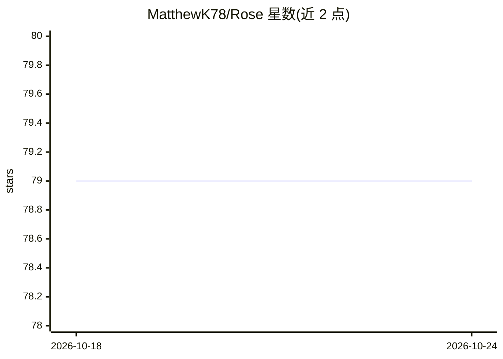

# MatthewK78/Rose

⭐ 79 · Python · Apache-2.0 · 推送 2026-10-09 · [GitHub](https://github.com/MatthewK78/Rose) · 个人维护

**无状态 PyTorch 优化器：用逐切片梯度范围归一化替代动量缓存**

Rose 是一个 PyTorch 优化器库，面向深度学习训练开发者。核心机制为瞬时逐切片范围归一化：不维护动量/方差等历史统计，直接从当前梯度按输出切片计算动态范围作为自适应尺度因子；附带变异系数信任门控、梯度中心化、解耦权重衰减（支持与学习率调度耦合）、BF16 随机舍入及可配置计算精度（默认 FP64）。内存占用仅为参数+梯度+工作区。需 Python ≥3.10、PyTorch ≥2.0，pip 安装。作者为独立研究者，v2 预告将加入谱化与改进的 bf16_sr。

## 筛选速览

| 维度 | 判定 | 备注 |
|---|---|---|
| AI 角色 | `ai-ecosystem` | LLM/agent 周边工具 |
| 许可风险 | `permissive` | Apache-2.0 |
| 部署形态 | `library` | 以包/库形式分发 |
| 模型依赖 | — | README 未给出锁定关系 |
| 硬件要求 | — | 无带数字的原话,不猜 |
| 安装摩擦 | `medium` | 含编译或系统依赖之一 |
| 成熟度 | — | 结构信号不足 |

## 能力要点

- 无状态设计：无动量/方差/步数计数器，内存占用为参数+梯度+工作区
- 逐输出切片的瞬时范围归一化替代历史方差估计
- CV 信任门控在切片范围噪声大时回退到全局均值估计
- BF16 随机舍入与默认 FP64 中间计算精度

## 适用场景

- 训练大模型时降低优化器内存开销
- 作为 AdamW 的替代选项用于微调/LoRA 等训练任务
- 低精度（BF16）训练中减少舍入截断漂移

## 场景标签

`微调` `模型训练` · 领域:训练与推理

## 证据(README 行号)

> L4:  PyTorch Optimizer
> L26: The answer is Rose's central mechanism: **instantaneous per-slice range normalization**. Instead of maintaining his
> L52: |**Stateless**|No momentum, variance estimates, or even step counters. Memory footprint: parameters + gradients + w

## 星数曲线

2026-10-18 79 → 2026-10-24 79（+0）

---
*卡片 v1 · prompt 1.4 · 生成 2026-10-24 · 置信度 high · 依据 README sha `76a9bde0c2a8` · [字段定义](../../DATASET.md)*
