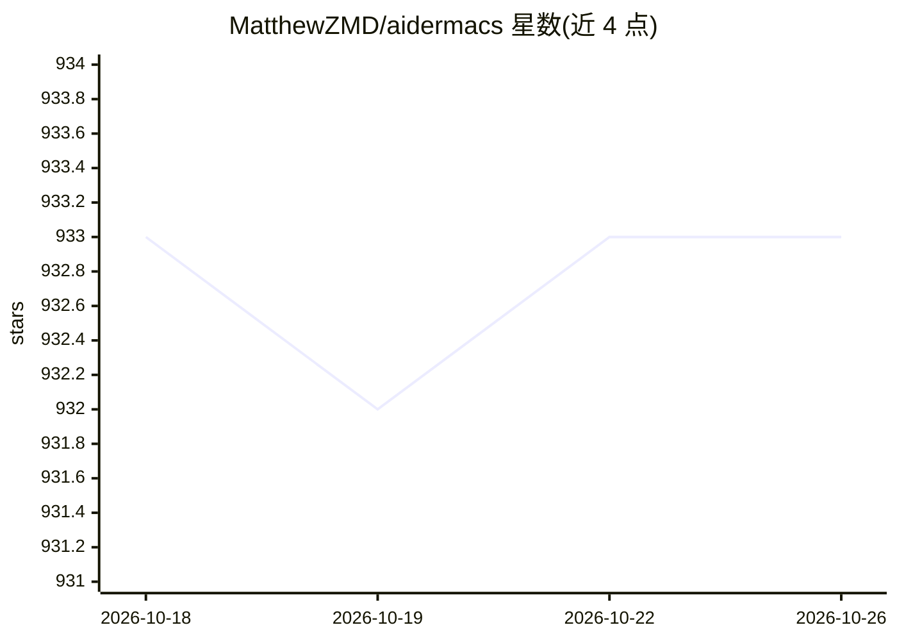

# MatthewZMD/aidermacs

⭐ 933 · Emacs Lisp · Apache-2.0 · 推送 2026-10-16 · [GitHub](https://github.com/MatthewZMD/aidermacs) · 个人维护

**在 Emacs 中集成 Aider 的 AI 结对编程前端**

Aidermacs 是将 Aider 命令行工具接入 Emacs 的 AI 结对编程包：提供类似 Magit 的 transient 菜单，覆盖会话管理、文件添加/移除（可只读）、代码修改、架构师模式（双模型分工推理与编辑）、语音命令与网络内容获取等操作。支持从 OpenAI、Anthropic、DeepSeek、Google Gemini、OpenRouter 等提供商动态拉取模型列表，内置 Ediff 查看 AI 改动。要求 Emacs ≥ 26.1 且本地安装 Aider，可从 MELPA/NonGNU ELPA 安装。

## 筛选速览

| 维度 | 判定 | 备注 |
|---|---|---|
| AI 角色 | `ai-ecosystem` | LLM/agent 周边工具 |
| 许可风险 | `permissive` | Apache-2.0 |
| 部署形态 | `None` |  |
| 模型依赖 | local-ok | 支持本地模型 |
| 硬件要求 | — | 无带数字的原话,不猜 |
| 安装摩擦 | `low` | 无编译、无系统依赖或容器化 |
| 成熟度 | `idea` | |

## 能力要点

- 类似 Magit 的 transient 菜单体系，覆盖文件管理与代码操作
- Architect 模式用 Architect/Editor 双模型分工
- 从 OpenAI、Anthropic、DeepSeek、Gemini、OpenRouter 动态获取模型列表
- 内置 Ediff 集成查看 AI 生成的改动

## 适用场景

- 在 Emacs 工作流内直接使用 Aider 进行 AI 辅助编码
- 细粒度控制 AI 可读/可改的文件范围
- 在架构师模式下让不同模型分别负责推理与代码编辑

## 场景标签

`编码 Agent` · 领域:编码与开发

## 证据(README 行号)

> L11: Aidermacs brings AI-powered development to Emacs by integrating Aider, one of the most powerful open-source AI pair
> L212: - Automatically fetches available models from supported providers (OpenAI, Anthropic, DeepSeek, Google Gemini, Ope
> L233: Aidermacs features an experimental mode using two specialized models for each coding task: an Architect model for 

## 星数曲线

2026-10-18 933 → 2026-10-26 933（+0）

---
*卡片 v1 · prompt 1.4 · 生成 2026-10-21 · 置信度 high · 依据 README sha `f151d4639295` · [字段定义](../../DATASET.md)*
