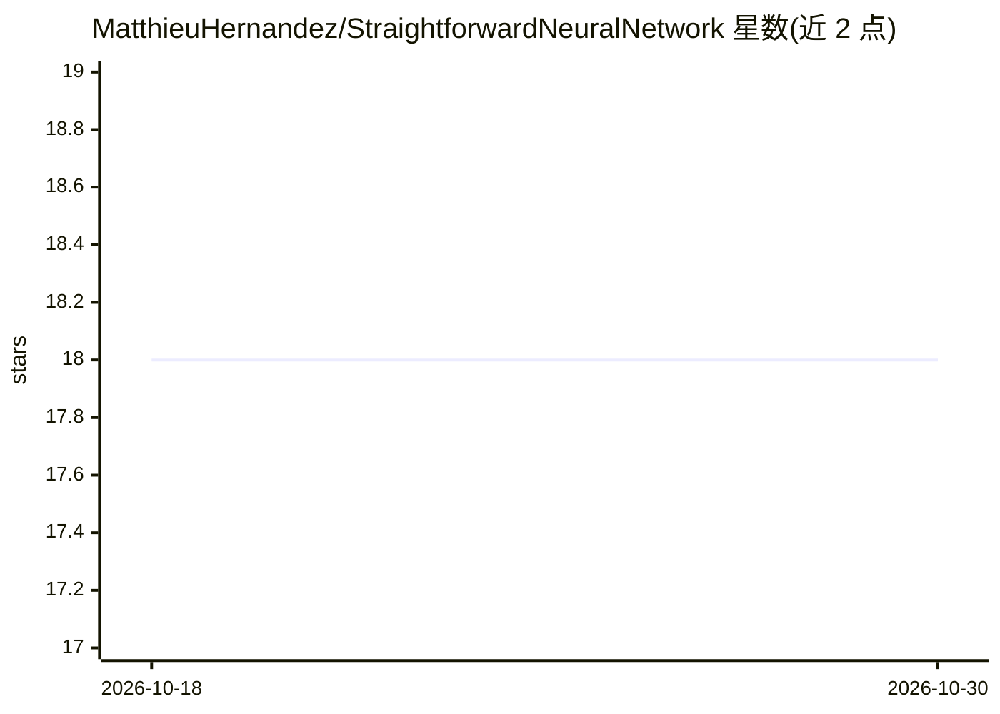

# MatthieuHernandez/StraightforwardNeuralNetwork

⭐ 18 · C++ · Apache-2.0 · 推送 2025-11-20 · [GitHub](https://github.com/MatthieuHernandez/StraightforwardNeuralNetwork) · 个人维护

**面向 CPU 的 C++20 神经网络库，少量代码创建训练网络**

开源 C++20 神经网络库，针对 CPU 优化，目标是用尽量少的代码（README 称不超过十行）完成神经网络的创建、训练与使用。支持图像分类（CIFAR-10/MNIST/Fashion-MNIST）、音频分类、时间序列回归与多变量分类等任务，并在 README 中列出各数据集上的测试结果与参数量。通过 CMake 从源码构建，覆盖 Linux（GCC/Clang）与 Windows（MSVC/VS2022）两条路径，测试需先下载提供的数据集。

## 筛选速览

| 维度 | 判定 | 备注 |
|---|---|---|
| AI 角色 | `ai-native` | 本体是模型或模型工具 |
| 许可风险 | `permissive` | Apache-2.0 |
| 部署形态 | `None` |  |
| 模型依赖 | — | README 未给出锁定关系 |
| 硬件要求 | — | 无带数字的原话,不猜 |
| 安装摩擦 | `medium` | 含编译或系统依赖之一 |
| 成熟度 | — | 结构信号不足 |

## 能力要点

- C++20 实现，针对 CPU 优化的神经网络库
- 少量代码即可创建、训练并使用神经网络
- 提供图像/音频/时间序列/多变量任务的测试结果表
- CMake 构建，支持 Linux GCC/Clang 与 Windows MSVC

## 适用场景

- 在 C++ 项目中集成轻量的神经网络训练与推理
- 做图像或音频分类、时间序列回归的原型实验
- 需要 CPU 环境下运行且无需 GPU 依赖的深度学习任务

## 场景标签

`模型训练` · 领域:训练与推理

## 证据(README 行号)

> L8: **Straightforward Neural Network** is an open source neural network library in C++20 optimized for CPU. The goal of 
> L14: |Dataset Name|Data type|Problem type|Score|Number of Parameters|

## 星数曲线

2026-10-18 18 → 2026-10-30 18（+0）

---
*卡片 v1 · prompt 1.4 · 生成 2026-10-29 · 置信度 high · 依据 README sha `a2f13fd5cdd1` · [字段定义](../../DATASET.md)*
