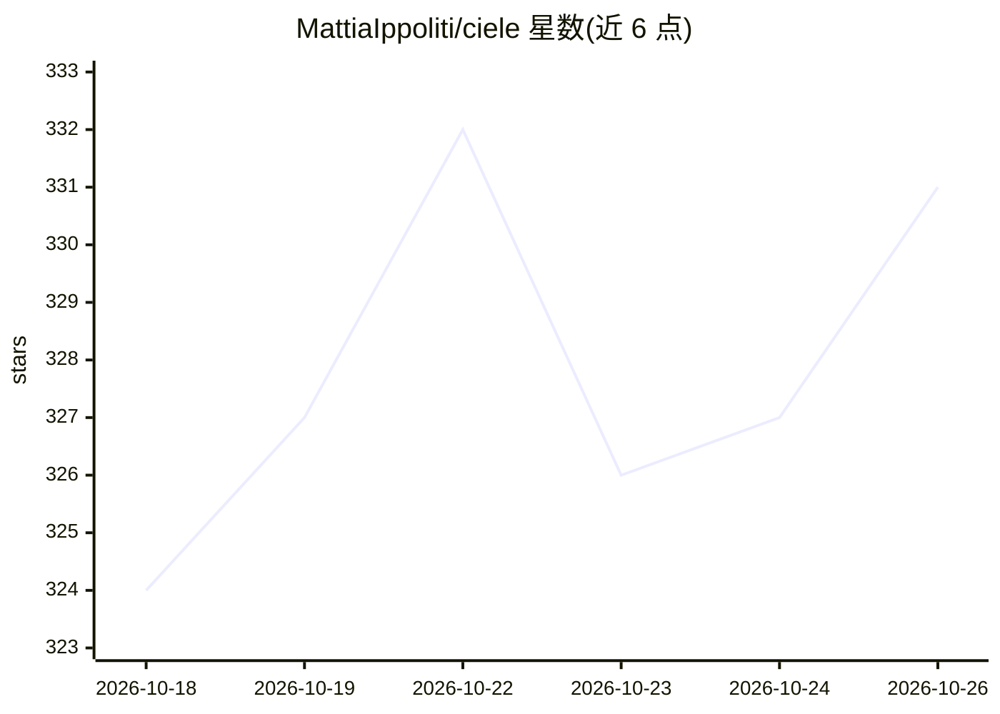

# MattiaIppoliti/ciele

⭐ 331 · TypeScript · NOASSERTION · 推送 2026-10-25 · [GitHub](https://github.com/MattiaIppoliti/ciele) · [官网](https://ciele.app) · 组织维护

**自托管的知识问答 AI 助手构建与运营平台**

开源（AGPL-3.0）的可自托管 AI 助手平台：从组织的网站、文件与 FAQ 构建知识库，通过意图分类的流程引擎路由回答，无法回答时升级到人工客服台；提供对话收件箱、分析视图与回答质量追踪，多租户由数据库行级安全隔离。聊天组件可嵌入外部站点。支持离线运行，只需对接任意兼容 OpenAI chat/embeddings API 的服务。一条命令 bootstrap 部署，另有同核心的托管版 Ciele Cloud。

## 筛选速览

| 维度 | 判定 | 备注 |
|---|---|---|
| AI 角色 | `ai-native` | 本体是模型或模型工具 |
| 许可风险 | `none` | NOASSERTION |
| 部署形态 | `None` |  |
| 模型依赖 | — | README 未给出锁定关系 |
| 硬件要求 | — | 无带数字的原话,不猜 |
| 安装摩擦 | `low` | 无编译、无系统依赖或容器化 |
| 成熟度 | `idea` | |

## 能力要点

- 从网站/文件/FAQ 构建知识库，回答附引用来源
- 意图分类路由的流程引擎，生成行为限定在知识检索内
- 对话收件箱、回答质量追踪与健康告警
- 多租户隔离由数据库行级安全实现

## 适用场景

- 为组织搭建基于自有知识的可嵌入客服助手
- 知识不足时把对话升级到人工客服台
- 内部知识问答并追踪回答质量

## 场景标签

`RAG` `文档问答` `聊天机器人` · 领域:对话与助手

## 证据(README 行号)

> L3: **Build, test, and publish AI assistants that answer from your own knowledge.**
> L5: Embeddable chat widgets that answer from your organization's websites, files, and
> L40: - **Knowledge**: crawl websites, upload files, curate FAQ pairs. Answers cite

## 星数曲线

2026-10-18 324 → 2026-10-26 331（+7）

---
*卡片 v1 · prompt 1.4 · 生成 2026-10-21 · 置信度 high · 依据 README sha `ccee5bfeb8bf` · [字段定义](../../DATASET.md)*
