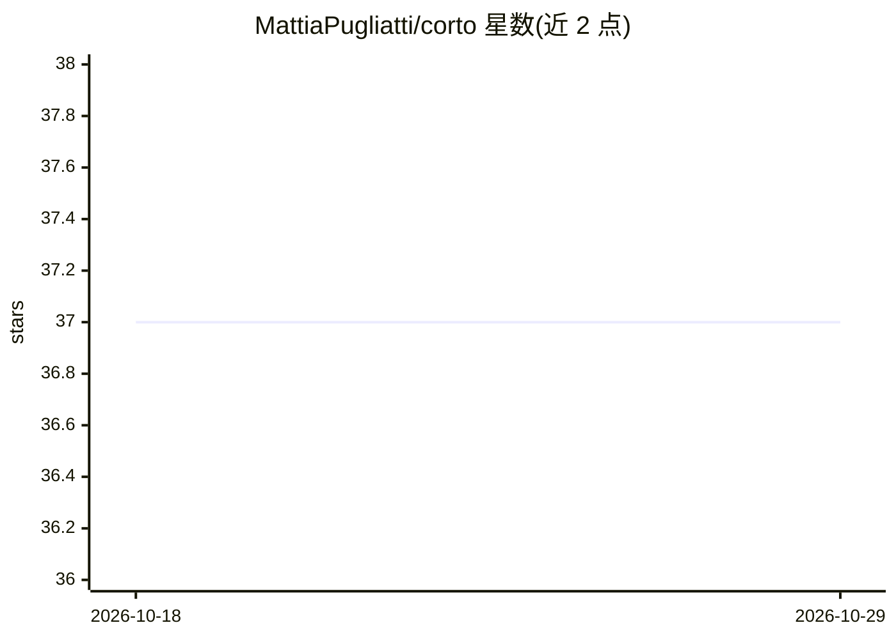

# MattiaPugliatti/corto

⭐ 37 · Python · MIT · 推送 2026-10-09 · [GitHub](https://github.com/MattiaPugliatti/corto) · 组织维护

**天体与航天器合成图像-标签对生成库（基于 Blender bpy）**

基于 Blender bpy 4.2.0 的 Python 库，用于生成天体（小行星、月球、火星-火卫-火卫二等）与人工航天器的合成图像及标签对，输出深度图、法线图、实例分割掩膜、YOLO 格式陨石坑标签等，支持多种光照散射 OSL 着色器（Hapke、Lambertian 等）与 EEVEE/CYCLES 渲染。最初为 Didymos 系统 Milani 任务图像处理开发，提供 11 个教程场景（Eros、Bennu、Didymos、Moon 等），输入场景需从 Google Drive 下载。使用 bpy 4.2.0 与 Python 3.11.7。

## 筛选速览

| 维度 | 判定 | 备注 |
|---|---|---|
| AI 角色 | `ai-ecosystem` | LLM/agent 周边工具 |
| 许可风险 | `permissive` | MIT |
| 部署形态 | `library` | 以包/库形式分发 |
| 模型依赖 | — | README 未给出锁定关系 |
| 硬件要求 | — | 无带数字的原话,不猜 |
| 安装摩擦 | `low` | 无编译、无系统依赖或容器化 |
| 成熟度 | — | 结构信号不足 |

## 能力要点

- 生成图像-标签对：深度图、掩膜、实例分割、YOLO 陨石坑标签
- 多种 OSL 光照散射着色器（Hapke、Lambertian、Minnaert 等）
- 覆盖 Eros、Bennu、Didymos、Moon、Mars-Phobos-Deimos 等 11 个教程场景
- 支持 EEVEE 简化渲染与 CYCLES 路径追踪/光线追踪

## 适用场景

- 为陨石坑检测与导航算法生成训练数据
- 为航天器图像处理算法生成实例分割标签
- 多体系统（行星-卫星）合成图像数据集生成
- 相机标定与散射律研究的球体图像生成

## 场景标签

 · 领域:航天工程/计算机视觉数据生成

## 证据(README 行号)

> L2: The Celestial Object Rendering TOol (CORTO) is a Python library that can be used to generate synthetic image-label p
> L32: CORTO can be used in a variety of lunar applications from far, medium, and close navigation regimes. For example, y

## 星数曲线

2026-10-18 37 → 2026-10-29 37（+0）

---
*卡片 v1 · prompt 1.4 · 生成 2026-10-25 · 置信度 high · 依据 README sha `5d94bb97ebc4` · [字段定义](../../DATASET.md)*
