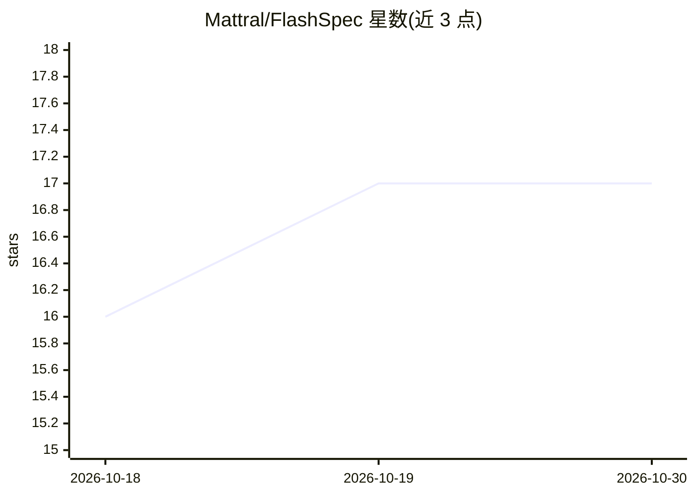

# Mattral/FlashSpec

⭐ 17 · Python · Apache-2.0 · 推送 2026-10-29 · [GitHub](https://github.com/Mattral/FlashSpec) · [官网](https://pypi.org/project/flashspec/) · 个人维护

**无损投机解码库：加速 HuggingFace 因果语言模型的单请求推理**

Python 库，包裹已有的 HuggingFace 因果语言模型与共享 tokenizer 的较小 drafter：drafter 提议 token，目标模型一次前向验证，贪心模式下输出与原模型一致（fp16 平局除外），采样时分布相同。含静态缓存 CUDA 图快速路径、prompt-lookup/composite/bandit 三类 drafter 策略，以及可选的 OpenAI 兼容 HTTP 服务器（无流式、无连续批处理、单进程单设备）。测量范围限于一组模型、Tesla T4、batch 1；CPU 与 batch>1 场景已声明未加速或未测量。

## 筛选速览

| 维度 | 判定 | 备注 |
|---|---|---|
| AI 角色 | `ai-ecosystem` | LLM/agent 周边工具 |
| 许可风险 | `permissive` | Apache-2.0 |
| 部署形态 | `self-host` | docker 或自建部署 |
| 模型依赖 | — | README 未给出锁定关系 |
| 硬件要求 | — | 无带数字的原话,不猜 |
| 安装摩擦 | `low` | 无编译、无系统依赖或容器化 |
| 成熟度 | `idea` | |

## 能力要点

- 贪心模式输出与原模型一致（fp16 平局除外），采样分布相同
- 静态缓存 CUDA 图编译路径，可 compile=False 跳过
- 模型 drafter / prompt-lookup / composite 三类无损 drafter，另有实验性 bandit 选择器（UCB1/Thompson）
- 提供 OpenAI 兼容服务器与 GHCR GPU 容器镜像

## 适用场景

- 在单张 CUDA GPU 上以 batch 1 加速 HuggingFace 模型推理且不改变输出
- 代码编辑、引用等输出复述提示词的场景用内置 prompt-lookup drafter，免第二个模型
- 用容器镜像快速起一个 OpenAI 兼容的加速推理端点

## 场景标签

`推理引擎` · 领域:训练与推理

## 证据(README 行号)

> L14: FlashSpec wraps an existing HuggingFace causal LM and a smaller drafter that shares its tokenizer: the drafter prop
> L20: - you run a HuggingFace causal LM on a CUDA GPU, one request at a time (batch 1);

## 星数曲线

2026-10-18 16 → 2026-10-30 17（+1）

---
*卡片 v1 · prompt 1.4 · 生成 2026-10-30 · 置信度 high · 依据 README sha `80bb9c8dfd83` · [字段定义](../../DATASET.md)*
