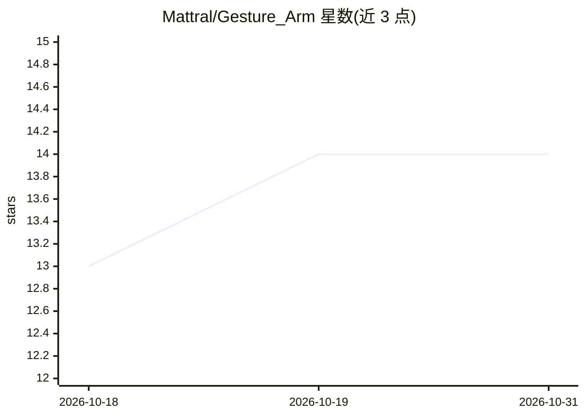

# Mattral/Gesture_Arm

⭐ 14 · Python · Apache-2.0 · 推送 2026-06-10 · [GitHub](https://github.com/Mattral/Gesture_Arm) · 个人维护

**低成本机械臂实时控制：手势+语音多模态输入，LSTM 稳定输出**

面向低成本机器人（Arduino Uno + 舵机机械臂 + 移动底盘，BOM 约 45 美元）的实时多模态控制系统：摄像头经 MediaPipe 提取手部关键点，通过在自采数据上训练的单层滑动窗口 LSTM 输出稳定舵机指令，右手控制底盘、左手控制机械臂，语音命令（Google Speech API）并行运行；另提供几何逆运动学模式。支持无硬件仿真模式与 Docker。注意基准数字来自单一硬件配置。

## 筛选速览

| 维度 | 判定 | 备注 |
|---|---|---|
| AI 角色 | `ai-native` | 本体是模型或模型工具 |
| 许可风险 | `permissive` | Apache-2.0 |
| 部署形态 | `self-host` | docker 或自建部署 |
| 模型依赖 | — | README 未给出锁定关系 |
| 硬件要求 | — | 无带数字的原话,不猜 |
| 安装摩擦 | `low` | 无编译、无系统依赖或容器化 |
| 成熟度 | — | 结构信号不足 |

## 能力要点

- 滑动窗口 15 帧 LSTM 平滑 MediaPipe 关键点抖动，输出稳定舵机命令
- 手势+语音并行控制，语音'stop'最高优先级
- 几何逆运动学模式（--ik），工作区外回退到 LSTM/baseline
- --no-hardware 仿真模式与 Docker 镜像，无需 Arduino 即可运行

## 适用场景

- 用低成本硬件搭建手势+语音控制的机械臂小车
- 无硬件情况下仿真测试视觉与控制流程
- 在自己手势数据上训练个性化的 LSTM 稳定器

## 场景标签

`多模态` · 领域:感知与多模态

## 证据(README 行号)

> L24: This project adds a **sliding-window LSTM** between the landmark extractor and the servo controller. The LSTM is tr

## 星数曲线

2026-10-18 13 → 2026-10-31 14（+1）

---
*卡片 v1 · prompt 1.4 · 生成 2026-10-31 · 置信度 mid · 依据 README sha `858f227d0fc4` · [字段定义](../../DATASET.md)*
