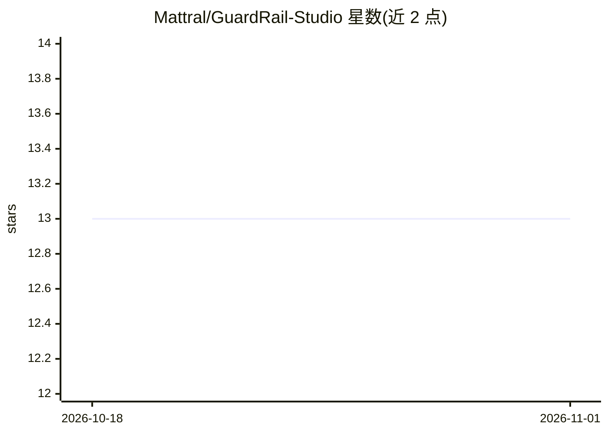

# Mattral/GuardRail-Studio

⭐ 13 · Python · Apache-2.0 · 推送 2026-09-12 · [GitHub](https://github.com/Mattral/GuardRail-Studio) · 个人维护

**LLM 防火墙的控制面板：管理提示词注入与 PII 检测代理**

围绕第三方 Rust 反向代理 guardrail-cli（guardrail-rs）构建的控制平面：代理在请求到达上游 LLM 前依据正则规则判定允许/脱敏/拦截（含提示词注入特征与 Luhn 校验的 PII 检测）。本仓库本身是 FastAPI 后端 + React 仪表盘，负责驱动流量、读取审计日志与 Prometheus 指标、编辑代理配置，自身不含检测逻辑。面向需要为 LLM API 部署防护层的开发者；README 明示未实现认证、限流、语义分类器，仅在单一预览环境验证。

## 筛选速览

| 维度 | 判定 | 备注 |
|---|---|---|
| AI 角色 | `ai-ecosystem` | LLM/agent 周边工具 |
| 许可风险 | `permissive` | Apache-2.0 |
| 部署形态 | `library` | 以包/库形式分发 |
| 模型依赖 | — | README 未给出锁定关系 |
| 硬件要求 | — | 无带数字的原话,不猜 |
| 安装摩擦 | `low` | 无编译、无系统依赖或容器化 |
| 成熟度 | `idea` | |

## 能力要点

- 驱动 guardrail-rs 代理的 allow/redact/block 决策与流量管理
- 读取审计日志与 Prometheus 指标，提供决策率图表
- PII 检测含 Luhn 校验（邮箱/电话/信用卡/SSN/IP/密钥）并做 token 脱敏
- 语义注入与毒性 ONNX 分类器列为未实现，正则方案存在绕过限制

## 适用场景

- 为上游 LLM API 部署提示词注入与 PII 防护代理
- 在仪表盘中查看代理的拦截/脱敏统计与审计日志
- 通过 Policy Editor 编辑自定义关键词策略规则

## 场景标签

`网络安全` · 领域:学习与行业

## 证据(README 行号)

> L29: This repository is the **control plane**: a FastAPI backend and React
> L30: dashboard that drive traffic through that proxy, read its audit log and
> L31: Prometheus metrics, and edit its configuration file. It does not contain any

## 星数曲线

2026-10-18 13 → 2026-11-01 13（+0）

---
*卡片 v1 · prompt 1.4 · 生成 2026-10-31 · 置信度 high · 依据 README sha `eaefc44e3299` · [字段定义](../../DATASET.md)*
