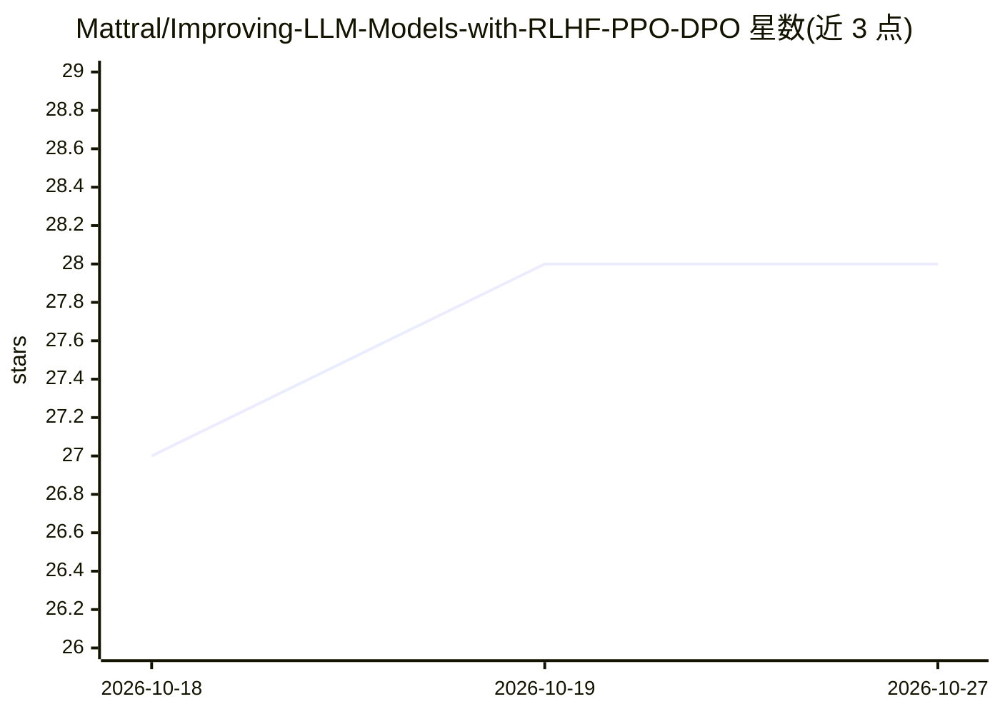

# Mattral/Improving-LLM-Models-with-RLHF-PPO-DPO

⭐ 28 · Python · Apache-2.0 · 推送 2026-06-06 · [GitHub](https://github.com/Mattral/Improving-LLM-Models-with-RLHF-PPO-DPO) · 个人维护

**从零实现的 RLHF 对齐训练框架，覆盖 PPO 与 DPO 全流程**

Python 编写的模块化 RLHF 训练框架，实现 SFT→奖励模型→PPO/DPO 完整对齐流水线：PPO 引擎含 GAE、截断代理目标与自适应 KL 惩罚；DPO 引擎为免奖励模型的偏好优化；另有 Pydantic v2 配置系统、Typer CLI 四命令与异步数据集管线。单张 T4 GPU 上 20 分钟内可完成 1K HH-RLHF 样本的 toy 模式验证；多节点（128+ GPU）架构仅设计未验证。面向 LLM 对齐的 ML 工程师与基础设施人员。

## 筛选速览

| 维度 | 判定 | 备注 |
|---|---|---|
| AI 角色 | `ai-ecosystem` | LLM/agent 周边工具 |
| 许可风险 | `permissive` | Apache-2.0 |
| 部署形态 | `library` | 以包/库形式分发 |
| 模型依赖 | — | README 未给出锁定关系 |
| 硬件要求 | — | 无带数字的原话,不猜 |
| 安装摩擦 | `medium` | 含编译或系统依赖之一 |
| 成熟度 | — | 结构信号不足 |

## 能力要点

- PPO（GAE+截断+KL）与免奖励模型的 DPO 双引擎
- 异步 rollout 环形缓冲与 NCCL 通信重叠设计
- 110+ 测试、100% 类型标注，Pydantic v2 配置校验
- 单 T4 GPU 20 分钟 toy 模式端到端验证

## 适用场景

- 在单卡上跑通 RLHF（SFT/奖励模型/PPO/DPO）全流程
- 研究 PPO/DPO 损失与分布式训练机制的源码实现
- 在多节点集群上做 LLM 对齐训练（多节点路径未经验证）

## 场景标签

`强化学习` · 领域:训练与推理

## 证据(README 行号)

> L13: This repo implements the full RLHF alignment pipeline — SFT → Reward Model → PPO and/or DPO — with production-engin
> L3: > A modular RLHF training framework implementing PPO and DPO from scratch. Validated end-to-end on a single T4 GPU i

## 星数曲线

2026-10-18 27 → 2026-10-27 28（+1）

---
*卡片 v1 · prompt 1.4 · 生成 2026-10-26 · 置信度 high · 依据 README sha `c9cb7aeb306c` · [字段定义](../../DATASET.md)*
