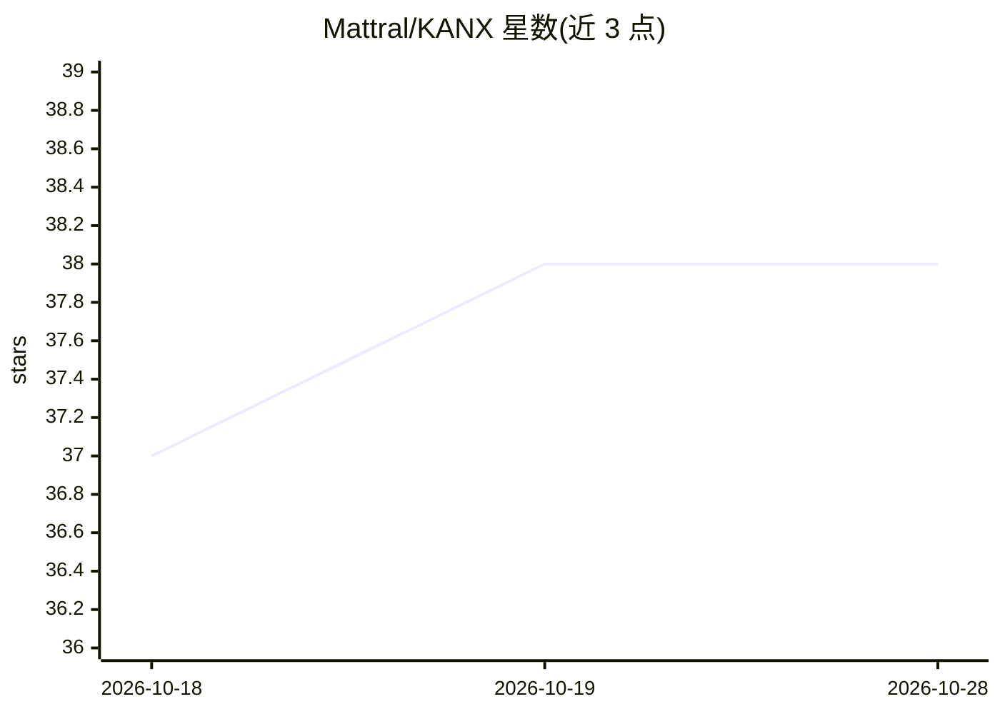

# Mattral/KANX

⭐ 38 · Python · Apache-2.0 · 推送 2026-10-27 · [GitHub](https://github.com/Mattral/KANX) · 个人维护

**面向生产部署的 Kolmogorov-Arnold 网络库（TF+PyTorch+ONNX）**

kanx 是一个 Python 的 Kolmogorov-Arnold Network（KAN）实现库，同时提供 TensorFlow 与 PyTorch 双后端及统一 API，支持 ONNX 导出、边缘剪枝、学习到的边函数可视化（matplotlib 图与 HTML viewer）、网格校准（静态 fit_grid_to_data 与训练中 update_grid_from_samples）、bfloat16/float16 精度与 XLA 编译。README 附带参数对齐的多基线基准（KAN vs MLP）及复现脚本，并声明不主张 KAN 普遍优于 MLP；MatrixKAN 标注为实验性且慢于 KAN。面向需要将 KAN 用于回归/预测并部署的开发者，提供 FastAPI 服务、Docker 镜像、Kubernetes manifests 与 Helm chart。

## 筛选速览

| 维度 | 判定 | 备注 |
|---|---|---|
| AI 角色 | `ai-native` | 本体是模型或模型工具 |
| 许可风险 | `permissive` | Apache-2.0 |
| 部署形态 | `self-host` | docker 或自建部署 |
| 模型依赖 | — | README 未给出锁定关系 |
| 硬件要求 | — | 无带数字的原话,不猜 |
| 安装摩擦 | `low` | 无编译、无系统依赖或容器化 |
| 成熟度 | — | 结构信号不足 |

## 能力要点

- TensorFlow 与 PyTorch 双后端统一 API，均支持 ONNX 导出
- 剪枝、边函数可视化（PNG/HTML）与符号拟合（SymbolicFitter）
- FastAPI REST 服务（/api/predict、/metrics Prometheus）+ Docker + K8s/Helm 部署物
- 提供参数对齐基准与复现脚本，并给出 KAN 不普遍优于 MLP 的限制声明

## 适用场景

- 用 KAN 做回归/预测并导出 ONNX 上线
- 训练后剪枝与可视化解释各边学到的函数
- 以 Docker/K8s + FastAPI 形式部署推理服务

## 场景标签

`推理引擎` · 领域:训练与推理

## 证据(README 行号)

> L3:  Production-grade Kolmogorov-Arnold Networks
> L40: 1. **Multi-Backend Support:** Native TensorFlow and PyTorch (`MatrixKAN`) implementations.
> L41: 2. **Real Deployment:** True ONNX export, FastAPI (`/api/predict`), Docker, and Kubernetes configs out-of-the-box.

## 星数曲线

2026-10-18 37 → 2026-10-28 38（+1）

---
*卡片 v1 · prompt 1.4 · 生成 2026-10-25 · 置信度 high · 依据 README sha `942ff99e9a5d` · [字段定义](../../DATASET.md)*
