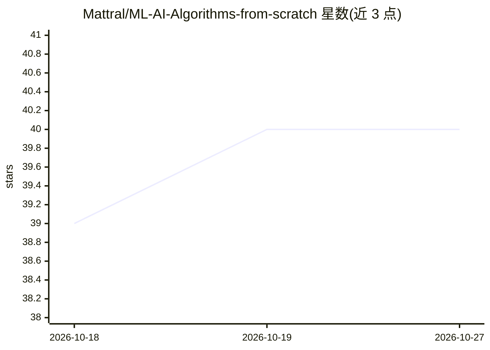

# Mattral/ML-AI-Algorithms-from-scratch

⭐ 40 · Python · Apache-2.0 · 推送 2026-10-22 · [GitHub](https://github.com/Mattral/ML-AI-Algorithms-from-scratch) · [官网](https://pypi.org/project/scratchkit/) · 个人维护

**60+ 机器学习/深度学习/强化学习/贝叶斯算法的 NumPy 从零实现库**

以纯 NumPy 从零实现 60 余种算法的教学向仓库：监督学习、无监督、贝叶斯方法（贝叶斯神经网络、高斯过程、HMM、卡尔曼滤波）、强化学习（DQN/DDPG/TD3/PPO/SAC）与神经网络系列。核心是 pip 可安装的 mlscratch 包（pip install scratchkit），提供 scikit-learn 风格的 fit/predict/transform API，运行时仅依赖 NumPy，scikit-learn 只作为测试套件的正确性参照（1,153 个测试）。附带 5 个可在 Colab 运行的已执行 notebook、独立脚本与推荐学习路径。README 声明以可读性换取性能，非生产级速度库，公开 API 在 1.0 前可能变动。

## 筛选速览

| 维度 | 判定 | 备注 |
|---|---|---|
| AI 角色 | `ai-native` | 本体是模型或模型工具 |
| 许可风险 | `permissive` | Apache-2.0 |
| 部署形态 | `library` | 以包/库形式分发 |
| 模型依赖 | — | README 未给出锁定关系 |
| 硬件要求 | — | 无带数字的原话,不猜 |
| 安装摩擦 | `low` | 无编译、无系统依赖或容器化 |
| 成熟度 | `idea` | |

## 能力要点

- 纯 NumPy 实现，运行时不调用 scikit-learn，scikit-learn 仅用于测试正确性校验
- mlscratch 包提供 fit/predict/transform 风格 API，含 1,153 个测试
- 覆盖贝叶斯方法（BNN/GP/HMM/卡尔曼滤波）与 RL（DDPG/TD3/PPO/SAC）等较少见于同类仓库的算法
- 5 个已执行的 Colab notebook 与推荐学习路径

## 适用场景

- 阅读代码学习经典 ML/DL/RL/贝叶斯算法的数学实现
- 在 Colab 上零本地配置运行真实数据集的算法示例
- 用 scikit-learn 风格 API 快速试验从零实现的估计器

## 场景标签

`教程课程` · 领域:学习与行业

## 证据(README 行号)

> L3: **60+ ML/AI/DL/RL/Bayesian algorithms implemented from scratch in NumPy — plus `mlscratch`, a pip-installable packag
> L13: > **What's new:** `src/mlscratch/` — a pip-installable package with `fit()`/`predict()`/`transform()` APIs, full ty
> L105: - The package layer (`src/mlscratch`) calls **only** NumPy at runtime — scikit-learn appears solely in the test su

## 星数曲线

2026-10-18 39 → 2026-10-27 40（+1）

---
*卡片 v1 · prompt 1.4 · 生成 2026-10-25 · 置信度 high · 依据 README sha `231d9d46249c` · [字段定义](../../DATASET.md)*
