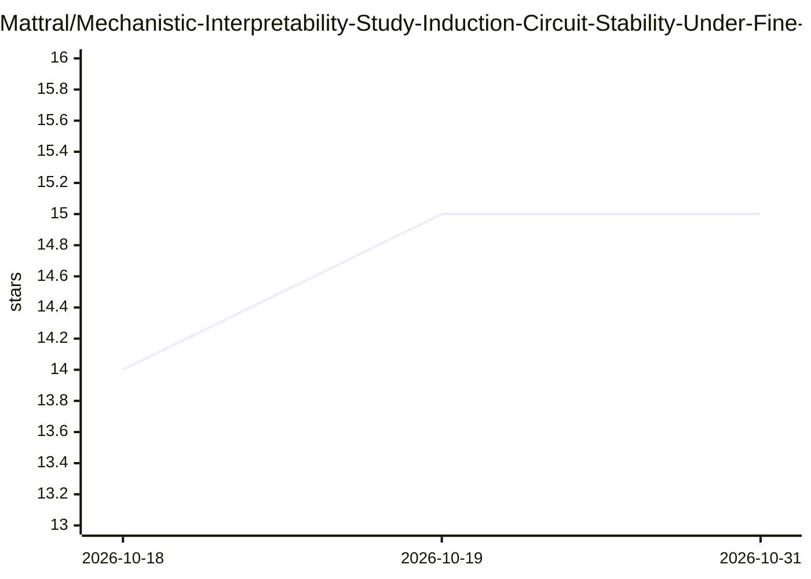

# Mattral/Mechanistic-Interpretability-Study-Induction-Circuit-Stability-Under-Fine-Tuning

⭐ 15 · Python · Apache-2.0 · 推送 2026-07-15 · [GitHub](https://github.com/Mattral/Mechanistic-Interpretability-Study-Induction-Circuit-Stability-Under-Fine-Tuning) · [官网](https://huggingface.co/spaces/Mattral/induction-circuit-stability) · 个人维护

**研究论文仓库：追踪微调下归纳头电路的稳定性变化**

一项机制可解释性研究及其配套代码：在 2 层 attention-only Transformer（attn-only-2l，L1H6 归纳头）上，从散文微调到 Python 代码，逐 checkpoint 测量归纳分数与激活修补归因，含三个随机种子与 TinyStories 对照。预注册假设，H1 未证实（电路增强而非消解），H2/H3 证实。实验结果与图表直接提交在仓库中便于复现；测试可在 CPU 运行，重训 checkpoint 需 GPU（约 80 分钟/种子/T4）。附 Hugging Face Spaces 交互面板。研究为预印本阶段。

## 筛选速览

| 维度 | 判定 | 备注 |
|---|---|---|
| AI 角色 | `ai-knowledge` | 知识聚合/清单类 |
| 许可风险 | `permissive` | Apache-2.0 |
| 部署形态 | `None` |  |
| 模型依赖 | — | README 未给出锁定关系 |
| 硬件要求 | — | 无带数字的原话,不猜 |
| 安装摩擦 | `low` | 无编译、无系统依赖或容器化 |
| 成熟度 | — | 结构信号不足 |

## 能力要点

- 逐 checkpoint（每 100 步）的 per-head 归纳分数与激活修补归因
- 3 个随机种子、代码/散文双条件的预注册对照实验
- 实验输出与图表直接提交仓库，克隆即可核对每个数字
- 22 类对抗探针验证增强后的电路仍保持前缀匹配选择性

## 适用场景

- 复现或核对归纳电路微调稳定性实验的全部数字
- 通过 HF Spaces 交互检查微调前后注意力模式
- 作为机制可解释性预注册实验设计（假设-阈值-决策日志）的参考案例

## 场景标签

 · 领域:AI 可解释性/安全研究

## 证据(README 行号)

> L6: A mechanistic interpretability study asking a simple question: does the
> L131: for the full numbers, and `paper/main.pdf` for the complete writeup

## 星数曲线

2026-10-18 14 → 2026-10-31 15（+1）

---
*卡片 v1 · prompt 1.4 · 生成 2026-10-30 · 置信度 high · 依据 README sha `7b8ed6b7aee7` · [字段定义](../../DATASET.md)*
