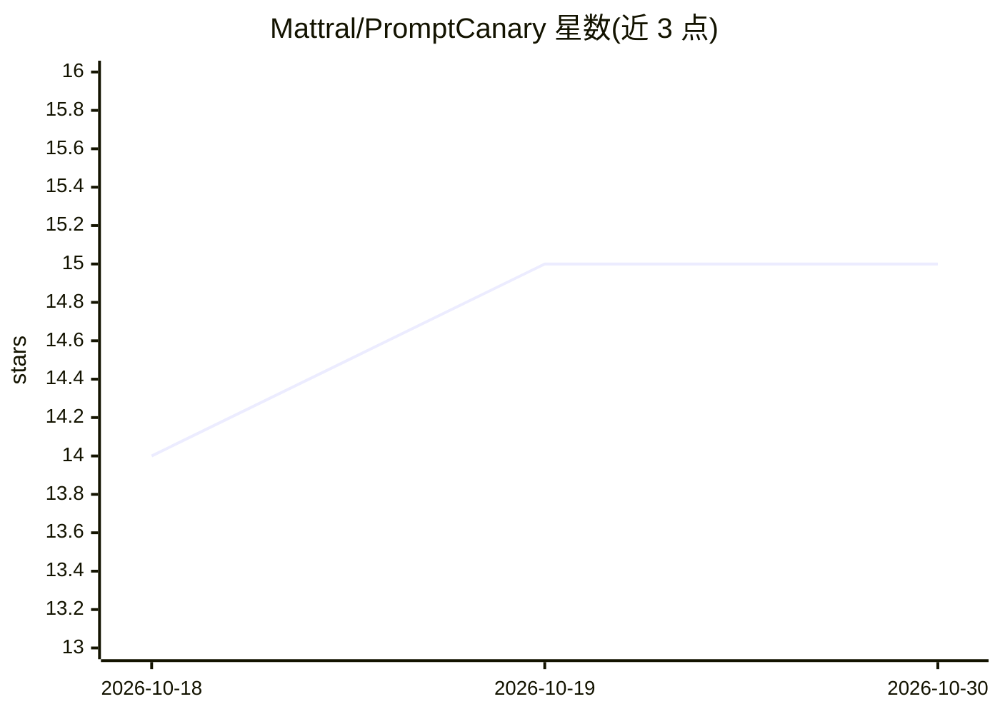

# Mattral/PromptCanary

⭐ 15 · Python · MIT · 推送 2026-07-11 · [GitHub](https://github.com/Mattral/PromptCanary) · 个人维护

**检测 LLM 提供商静默行为漂移的 CLI/SDK 监控工具**

面向运行生产 LLM 应用的开发者：当提供商在不改模型名、不公告的情况下更新模型，PromptCanary 通过探针套件自动捕获行为漂移。机制：用 canary.yaml 定义探针（格式/推理风格/安全拒答/工具调用/事实共 15 类），对指定 provider 跑基线，之后再次运行 compare 对比得分，--fail-on-drift 以非零退出码接入 CI。提供商接入通过 LiteLLM 统一层，支持 OpenAI/Anthropic/Gemini/Ollama/vLLM 等 100+。以 pip 包提供，含 CLI、Python SDK 与 GitHub Actions 集成。限制：依赖 LiteLLM 的 provider 支持，模型串可用性需自行核验。

## 筛选速览

| 维度 | 判定 | 备注 |
|---|---|---|
| AI 角色 | `ai-ecosystem` | LLM/agent 周边工具 |
| 许可风险 | `permissive` | MIT |
| 部署形态 | `library` | 以包/库形式分发 |
| 模型依赖 | local-ok | 支持本地模型 |
| 硬件要求 | — | 无带数字的原话,不猜 |
| 安装摩擦 | `low` | 无编译、无系统依赖或容器化 |
| 成熟度 | — | 结构信号不足 |

## 能力要点

- 15 个内置探针覆盖格式、推理风格、安全拒答、工具调用、事实五类漂移
- 通过 LiteLLM 支持 OpenAI/Anthropic/Gemini/Ollama/vLLM 等 100+ 提供商
- --fail-on-drift 非零退出码用于 CI 门禁，GitHub Actions 定时检查/PR 评论/自动开 issue
- 输出终端/Markdown/HTML/JSON 四种报告与分数趋势可视化

## 适用场景

- 生产 LLM 应用上线后定期检测模型行为回归
- CI 流水线中自动拦截 JSON 格式或工具调用漂移
- 用 Ollama/vLLM 本地模型做零成本金丝雀测试

## 场景标签

`LLM 可观测性` `模型评测` · 领域:评测与运维

## 证据(README 行号)

> L33: > *LLM providers frequently update their models without changing the model string or announcing behavioral shifts. 
> L67: - 🧪 **CI-ready** — `--fail-on-drift` exits non-zero for automated gating
> L233: PromptCanary works with any provider supported by LiteLLM — cloud or local, paid or free.

## 星数曲线

2026-10-18 14 → 2026-10-30 15（+1）

---
*卡片 v1 · prompt 1.4 · 生成 2026-10-30 · 置信度 high · 依据 README sha `c265638256a1` · [字段定义](../../DATASET.md)*
