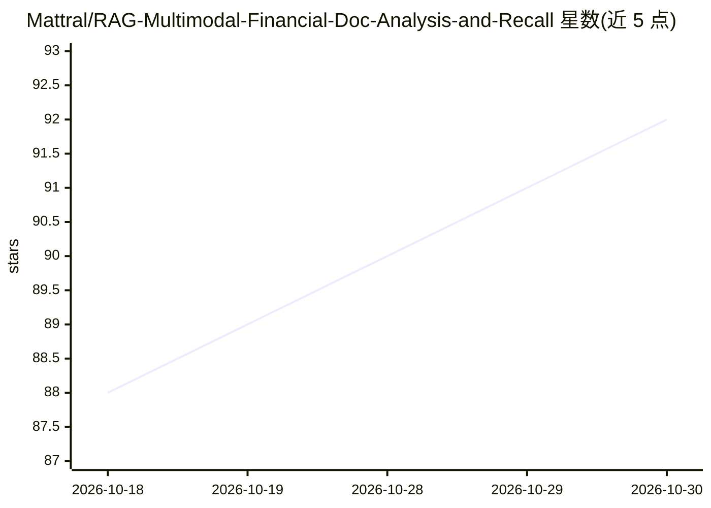

# Mattral/RAG-Multimodal-Financial-Doc-Analysis-and-Recall

⭐ 92 · Python · MIT · 推送 2026-10-14 · [GitHub](https://github.com/Mattral/RAG-Multimodal-Financial-Doc-Analysis-and-Recall) · 个人维护

**金融文档多模态 RAG 系统：图表理解、混合检索、数字护栏**

面向金融文档（财报等混合文本/表格/图表）的多模态 RAG 应用：解析 PDF 与表格，视觉 LLM 提取图表数值，dense+BM25 混合 RRF 检索，生成侧带数字溯源护栏、PII 脱敏（Presidio+正则）、受限算术解释器与 RAGAS 评测。各模型层（生成/视觉/嵌入/向量库）可通过配置切换供应商，含本地 vLLM 零 API 成本方案。提供 FastAPI REST、CLI、多租户、OpenTelemetry/Prometheus 观测与 K8s/Terraform 部署。README 自述局限：约 30% 金标问题检索不到支撑片段，延迟/成本未完成可复现测量，金标集为单人编写、Tesla 占比高。

## 筛选速览

| 维度 | 判定 | 备注 |
|---|---|---|
| AI 角色 | `ai-native` | 本体是模型或模型工具 |
| 许可风险 | `permissive` | MIT |
| 部署形态 | `library` | 以包/库形式分发 |
| 模型依赖 | local-ok | 支持本地模型 |
| 硬件要求 | — | 无带数字的原话,不猜 |
| 安装摩擦 | `low` | 无编译、无系统依赖或容器化 |
| 成熟度 | — | 结构信号不足 |

## 能力要点

- GPT-4o/Gemini/Qwen2-VL 视觉 LLM 提取图表数值，带回退链
- dense+BM25 混合 RRF 检索，附 119 题金标集离线测量结果
- 数字溯源护栏 + Program-of-Thought 受限算术解释器
- 全模型层可插拔，支持本地 vLLM 零 API 成本配置

## 适用场景

- 对财报等金融文档做带来源引用的问答
- 需要核对回答中数字是否有原文依据的金融分析
- 企业内多租户部署文档问答并接入监控告警体系

## 场景标签

`文档问答` `RAG` · 领域:知识与检索

## 证据(README 行号)

> L3: > **Production-grade multimodal RAG for financial document intelligence.**
> L28: |Charts contain the most important data but RAG ignores them|GPT-4o / Gemini / Qwen2-VL vision extraction — every c
> L30: |LLMs fabricate financial numbers|Numeric grounding guardrail — every stated number verified against source context

## 星数曲线

2026-10-18 88 → 2026-10-30 92（+4）

---
*卡片 v1 · prompt 1.4 · 生成 2026-10-23 · 置信度 high · 依据 README sha `231d303078a0` · [字段定义](../../DATASET.md)*
