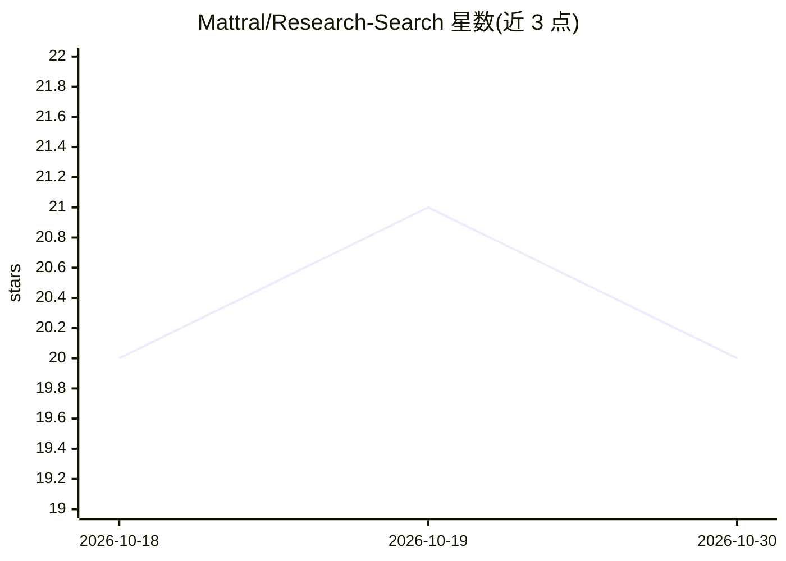

# Mattral/Research-Search

⭐ 20 · Python · MIT · 推送 2026-07-10 · [GitHub](https://github.com/Mattral/Research-Search) · 个人维护

**科研文献发现工具：跨 arXiv/S2/OpenAlex 搜索与 AI 摘要比对**

面向科研人员的文献探索 Web 应用（FastAPI + React + Neo4j）：同时检索 arXiv、Semantic Scholar、OpenAlex 三个数据库，提供 Gemini 驱动的论文摘要与 2-5 篇论文对比分析、基于 OpenAlex 元数据的 10 年趋势图表、工作区注释组织、BibTeX/Markdown 导出，以及 Neo4j 引文推荐。支持 JWT 认证、阅读清单与 arXiv 分类浏览。需 Python 3.11+、Node.js 18+，Neo4j 可选（缺省时图功能降级），AI 功能需 Gemini 或 Emergent API key；提供 Docker Compose 与 Kubernetes 部署。

## 筛选速览

| 维度 | 判定 | 备注 |
|---|---|---|
| AI 角色 | `ai-native` | 本体是模型或模型工具 |
| 许可风险 | `permissive` | MIT |
| 部署形态 | `self-host` | docker 或自建部署 |
| 模型依赖 | — | README 未给出锁定关系 |
| 硬件要求 | — | 无带数字的原话,不猜 |
| 安装摩擦 | `low` | 无编译、无系统依赖或容器化 |
| 成熟度 | — | 结构信号不足 |

## 能力要点

- 跨 arXiv/Semantic Scholar/OpenAlex 三源并行检索，可按源过滤开关
- Gemini 驱动的论文摘要、对比矩阵与 10 年趋势图表
- 工作区注释、阅读清单与 BibTeX/Markdown 导出
- Neo4j 引文/作者关系推荐，缺省时功能降级

## 适用场景

- 为文献综述查找并对比多篇相关论文
- 跟踪某主题十年的发文趋势
- 按课题组织论文收藏、注释并导出 BibTeX

## 场景标签

`科研工具` · 领域:学习与行业

## 证据(README 行号)

> L21: - AI-powered summarization and paper comparison
> L49: |**AI summaries**|Gemini-powered plain-language summaries with key findings|

## 星数曲线

2026-10-18 20 → 2026-10-30 20（+0）

---
*卡片 v1 · prompt 1.4 · 生成 2026-10-28 · 置信度 mid · 依据 README sha `694a18f96956` · [字段定义](../../DATASET.md)*
