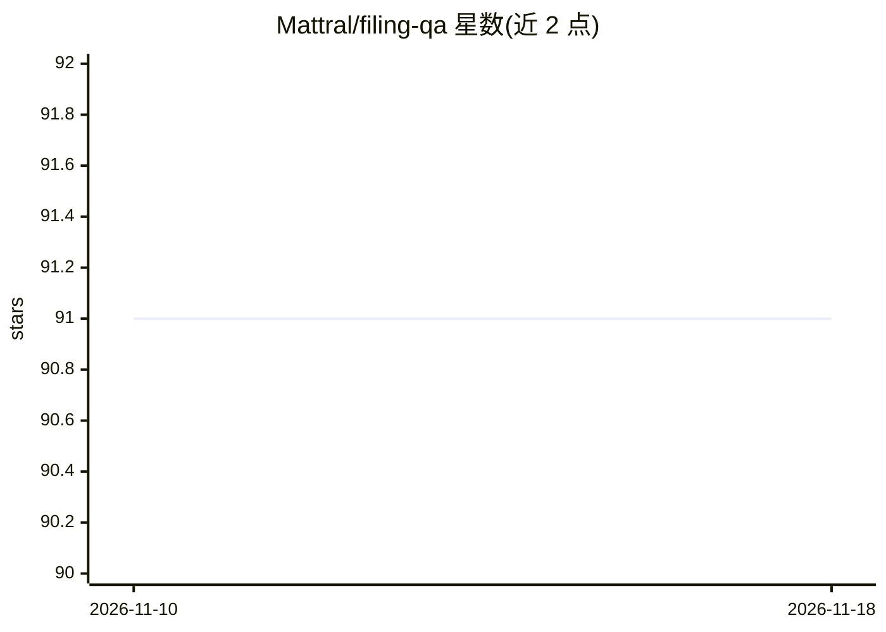

# Mattral/filing-qa

⭐ 91 · Python · MIT · 推送 2026-11-12 · [GitHub](https://github.com/Mattral/filing-qa) · 个人维护

**面向金融财报（10-K/10-Q、投资者材料）的多模态 RAG 问答系统**

对金融文档做多模态摄取与带引用问答：PDF 文本/表格解析、GPT-4o/Gemini/Qwen2-VL 视觉链提取图表数值、dense+BM25 混合 RRF 检索、交叉编码器重排、数值接地护栏（答案中每个数字对照原文核验）、受限解释器执行 Program-of-Thought 计算、PII 脱敏、多租户与 OpenTelemetry 可观测性。以 FastAPI 服务 + CLI + Helm/K8s 部署提供，模型层（生成/视觉/嵌入/向量库）均可单行配置切换。README 自述局限：完整摄取管线与延迟/成本尚未复现测量，约 30% 金标问题 top-5 无答案块，金标集为单人编写的 119 题。

## 筛选速览

| 维度 | 判定 | 备注 |
|---|---|---|
| AI 角色 | `ai-native` | 本体是模型或模型工具 |
| 许可风险 | `permissive` | MIT |
| 部署形态 | `library` | 以包/库形式分发 |
| 模型依赖 | local-ok | 支持本地模型 |
| 硬件要求 | — | 无带数字的原话,不猜 |
| 安装摩擦 | `low` | 无编译、无系统依赖或容器化 |
| 成熟度 | — | 结构信号不足 |

## 能力要点

- 混合 dense+BM25 RRF 检索 + 交叉编码器重排，附 119 题金标集离线评测
- 视觉 LLM 回退链提取图表数值（GPT-4o/Gemini/Qwen2-VL/本地 vLLM）
- 数值接地护栏：答案中每个数字对照来源上下文核验，PoT 计算用受限解释器执行
- 各模型层（生成/视觉/嵌入/向量库）可经 .env 单行切换，支持全开源零 API 成本配置

## 适用场景

- 对财报和投资者材料做带出处的问答并核验数字
- 自部署金融文档检索问答服务（多租户、K8s）
- 在本地 vLLM 上零 API 成本运行整套 RAG 管线

## 场景标签

`RAG` `文档问答` · 领域:知识与检索

## 证据(README 行号)

> L30: |LLMs fabricate financial numbers|Numeric grounding guardrail — every stated number verified against source context
> L72: filing-qa query "What was Q3 revenue?" --tenant demo --show-sources
> L158: |**Guardrails**|Numeric grounding + PII|Presidio + custom regex + restricted-interpreter PoT calculator|

## 星数曲线

2026-11-10 91 → 2026-11-18 91（+0）

---
*卡片 v1 · prompt 1.4 · 生成 2026-11-17 · 置信度 high · 依据 README sha `cfdd14c1629e` · [字段定义](../../DATASET.md)*
