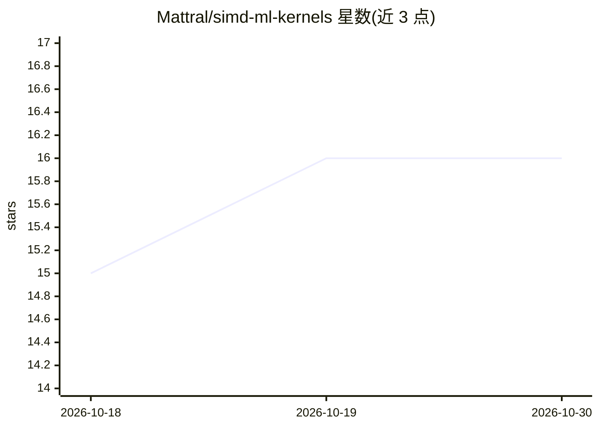

# Mattral/simd-ml-kernels

⭐ 16 · C++ · Apache-2.0 · 推送 2026-10-21 · [GitHub](https://github.com/Mattral/simd-ml-kernels) · 个人维护

**面向开发者的手写 x86 SIMD 神经网络算术内核 C++/Python 库**

C++17 编写的 x86 SIMD 内核库，覆盖 GEMM、decode 用矩阵-向量乘（GEMV）、INT8/FP16/BF16 与 ggml Q8_0/Q4_0 量化路径、激活与归一化函数。每个内核带可移植 C++ 版本，运行时按 CPU 选择 AVX2/AVX-512/VNNI 路径，并对照 float64 参考实现测试、与 OpenBLAS 或 PyTorch 同核同进程基准测试。通过 Python 在 NumPy 数组上调用，附 examples/llama 用这些内核加 NumPy 以 Python 循环运行 Llama-3.2-1B 生成文本（非运行时）。默认单线程、无 autograd、无模型运行时与 batching，仅 x86-64 向量化，版本 pre-1.0（0.3.0）。

## 筛选速览

| 维度 | 判定 | 备注 |
|---|---|---|
| AI 角色 | `ai-ecosystem` | LLM/agent 周边工具 |
| 许可风险 | `permissive` | Apache-2.0 |
| 部署形态 | `self-host` | docker 或自建部署 |
| 模型依赖 | — | README 未给出锁定关系 |
| 硬件要求 | — | 无带数字的原话,不猜 |
| 安装摩擦 | `low` | 无编译、无系统依赖或容器化 |
| 成熟度 | `idea` | |

## 能力要点

- 运行时按 CPU 选择 AVX2 / AVX-512 / VNNI 内核路径
- 支持 FP32/FP16/BF16/INT8 及 ggml Q8_0/Q4_0 量化权重格式
- 每个内核对照 float64 参考测试并声明误差界
- examples/llama 用这些内核与 NumPy 从 GGUF 权重生成文本，FP32 输出与 Hugging Face transformers token 级一致

## 适用场景

- 从 NumPy 调用 decode 形状的 x @ W.T 计算（FP32/FP16/BF16 权重）
- 阅读带测量依据的手写 SIMD 内核实现，学习如何逼近硬件访存上限
- 在同一台机器上对比 scalar/AVX2/AVX-512 代码路径

## 场景标签

 · 领域:机器学习基础设施/高性能计算

## 证据(README 行号)

> L9: simd-ml-kernels is a C++17 library of hand-written x86 SIMD kernels for the
> L16: in the same run. You call it from Python on NumPy arrays; the reasons behind
> L81: single-threaded by default, has no autograd, no model runtime and no batching

## 星数曲线

2026-10-18 15 → 2026-10-30 16（+1）

---
*卡片 v1 · prompt 1.4 · 生成 2026-10-30 · 置信度 mid · 依据 README sha `c91d8917625e` · [字段定义](../../DATASET.md)*
