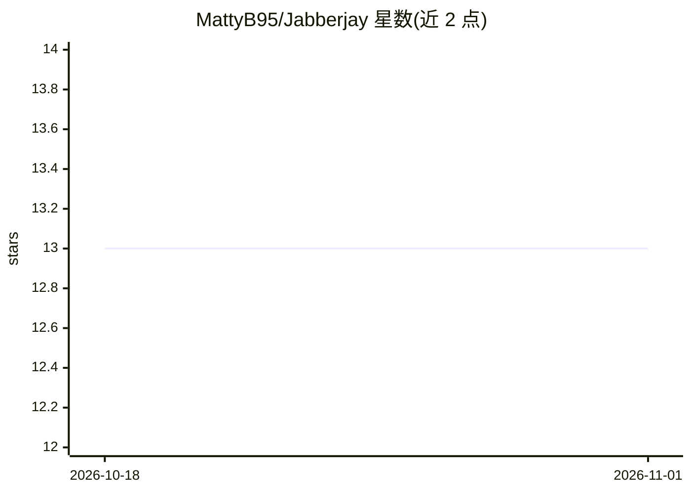

# MattyB95/Jabberjay

⭐ 13 · Python · MIT · 推送 2026-10-28 · [GitHub](https://github.com/MattyB95/Jabberjay) · [官网](https://mattyb95.github.io/Jabberjay/) · 个人维护

**合成语音检测工具库：统一 API/CLI 判别音频真伪**

面向开发者的合成语音（AI 生成语音）检测 Python 库与命令行工具：将 ViT、AST、Wav2Vec2、HuBERT、WavLM、Spectra 系列、RawNet2 及 KNN 经典基线等十个模型家族收拢到同一 API 下，输入音频文件即可输出统一格式的 DetectionResult（Bonafide/Spoof 标签、置信度、完整分数分布）。模型首次使用时从 Hugging Face Hub 自动下载并本地缓存，支持预加载音频与多模型批量运行。要求 Python ≥ 3.12；开发者贡献需 uv 与 just。

## 筛选速览

| 维度 | 判定 | 备注 |
|---|---|---|
| AI 角色 | `ai-native` | 本体是模型或模型工具 |
| 许可风险 | `permissive` | MIT |
| 部署形态 | `library` | 以包/库形式分发 |
| 模型依赖 | — | README 未给出锁定关系 |
| 硬件要求 | — | 无带数字的原话,不猜 |
| 安装摩擦 | `low` | 无编译、无系统依赖或容器化 |
| 成熟度 | — | 结构信号不足 |

## 能力要点

- 十个模型家族统一在同一 Python API 与 CLI 下
- 所有模型返回统一 DetectionResult（label/confidence/scores）
- 模型从 Hugging Face Hub 自动下载并本地缓存，权重在进程内复用
- 提供预加载音频以在同一片段上高效运行多个模型

## 适用场景

- 用一条命令检测音频是人声还是 AI 合成
- 在同一音频片段上对比多个检测模型的结果
- 在 Python 应用中集成合成语音检测能力

## 场景标签

`网络安全` · 领域:学习与行业

## 证据(README 行号)

> L20: Synthetic voice detection is a fragmented landscape — state-of-the-art models are scattered across research reposit
> L23: - **Unified output** — every model returns the same `DetectionResult` with `label`, `confidence`, and `scores`

## 星数曲线

2026-10-18 13 → 2026-11-01 13（+0）

---
*卡片 v1 · prompt 1.4 · 生成 2026-10-31 · 置信度 high · 依据 README sha `39d5854a448c` · [字段定义](../../DATASET.md)*
