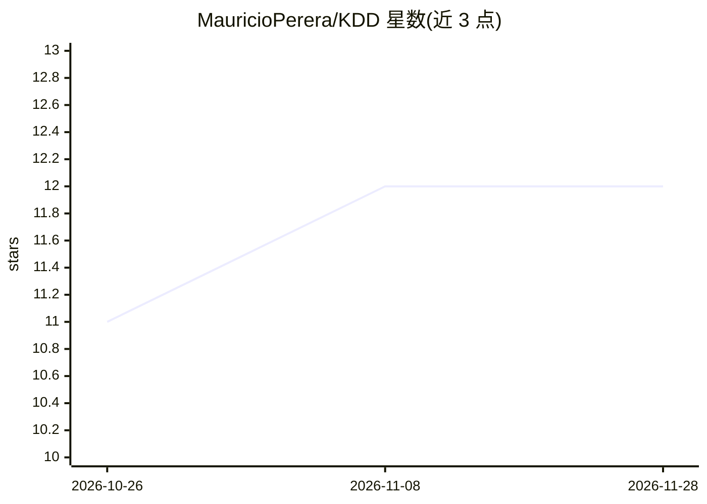

# MauricioPerera/KDD

⭐ 12 · Python · MIT · 推送 2026-11-27 · [GitHub](https://github.com/MauricioPerera/KDD) · [官网](https://mauricioperera.github.io/KDD/) · 个人维护

**面向 AI agent 开发流程的契约治理模板仓库**

一个 GitHub 模板仓库，用于按 KDD 方法论治理开发流程：以 OKF（markdown+YAML frontmatter 的知识节点）组织知识库，以 CCDD 合约约束 AI agent 产出，内置 stdlib 实现的确定性合约校验器（无 LLM、无网络调用）与 GitHub Actions CI。提供任务管理 CLI、Git 分支流转审计，以及可选的 KDD-Board 可视化看板（Kanban、Blind Secrets Vault、WebMCP 桥）。覆盖安全、合规、隐私、可访问性等 8 个规则域，并支持通过 reusable workflow / composite action 在非 fork 仓库中调用校验门。

## 筛选速览

| 维度 | 判定 | 备注 |
|---|---|---|
| AI 角色 | `ai-ecosystem` | LLM/agent 周边工具 |
| 许可风险 | `permissive` | MIT |
| 部署形态 | `None` |  |
| 模型依赖 | — | README 未给出锁定关系 |
| 硬件要求 | — | 无带数字的原话,不猜 |
| 安装摩擦 | `low` | 无编译、无系统依赖或容器化 |
| 成熟度 | — | 结构信号不足 |

## 能力要点

- 确定性合约校验器（stdlib 实现，无 LLM、无网络）
- OKF 知识节点 + CCDD 合约的方法论模板，克隆即用
- Git 任务 CLI：创建、审批、启动/阻塞/恢复与完成审计
- KDD-Board 可视化看板，含 WebMCP 桥与密钥注入保险库

## 适用场景

- 用 AI 编码 agent 开发时，通过确定性合约约束其产出
- 团队需要带人工审批门的 agent 任务看板
- 在非 fork 仓库中以 GitHub Action 复用 KDD 校验门
- 以声明式规则引擎审计安全/合规/隐私等扫描产物

## 场景标签

 · 领域:开发者工具/软件工程方法论

## 证据(README 行号)

> L20: This is a template repository for projects that implement the **Knowledge-Driven Development (KDD)** methodology, w
> L37: - `scripts/validate_contracts.py`: Deterministic contract validator (stdlib, no LLM, no network).
> L85: 3. When delegating work to an agent (e.g. an AI coding agent), the agent will read `.agents/AGENTS.md` and immediat

## 星数曲线

2026-10-26 11 → 2026-11-28 12（+1）

---
*卡片 v1 · prompt 1.4 · 生成 2026-11-18 · 置信度 high · 依据 README sha `b832fbd8e439` · [字段定义](../../DATASET.md)*
