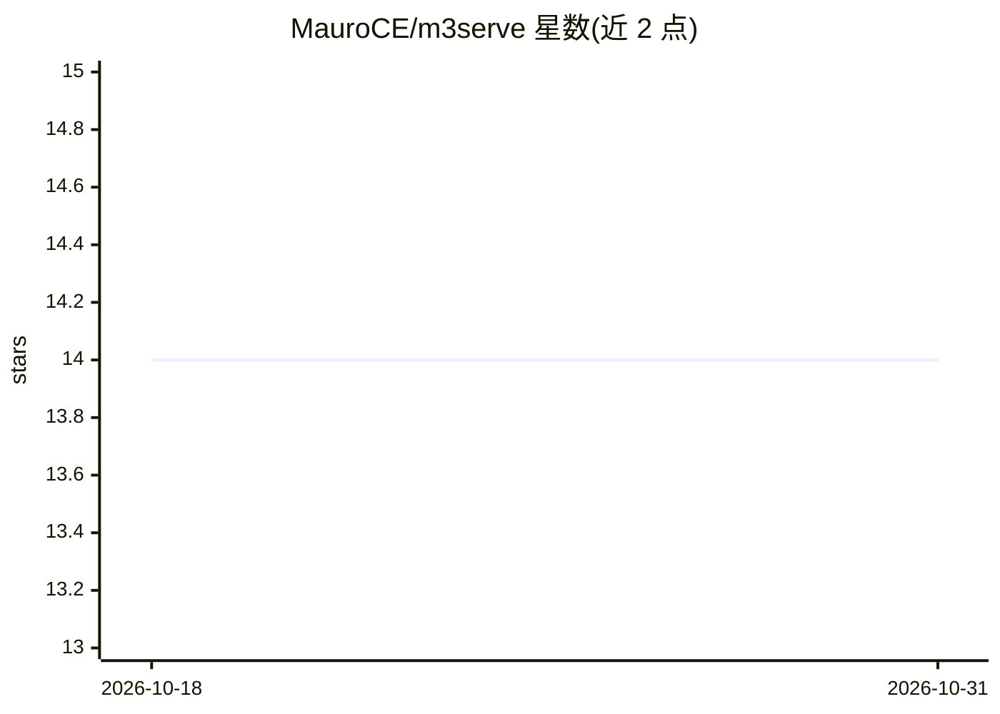

# MauroCE/m3serve

⭐ 14 · Python · MIT · 推送 2026-05-04 · [GitHub](https://github.com/MauroCE/m3serve) · 个人维护

**BAAI/bge-m3 专用嵌入推理引擎：单次调用返回稠密/稀疏/ColBERT 向量**

面向 BAAI/bge-m3 模型的轻量级异步 Python 推理库：单次 embed() 调用可同时返回 dense、sparse 与 ColBERT 多向量嵌入。内部用三个后台线程做流水线（CPU 分词、GPU 前向、后处理），按 token 长度排队并动态合并批次，减少 GPU 空闲与 padding 浪费。支持 CUDA/MPS/CPU、fp16、torch.compile 与 Flash Attention 2/3 自动选择。限制：单模型单 GPU、无副本与多卡切分；默认 5ms 合并窗口在低并发时增加固定延迟，中并发下 p99 可为 p50 的 5-10 倍。以 pip 包提供，附 Colab 基准与教程 notebook。

## 筛选速览

| 维度 | 判定 | 备注 |
|---|---|---|
| AI 角色 | `ai-ecosystem` | LLM/agent 周边工具 |
| 许可风险 | `permissive` | MIT |
| 部署形态 | `library` | 以包/库形式分发 |
| 模型依赖 | — | README 未给出锁定关系 |
| 硬件要求 | — | 无带数字的原话,不猜 |
| 安装摩擦 | `medium` | 含编译或系统依赖之一 |
| 成熟度 | — | 结构信号不足 |

## 能力要点

- 单次调用返回 dense + sparse + ColBERT 三种嵌入
- 三线程流水线（分词/GPU 前向/后处理）+ 按 token 长度动态批处理
- Flash Attention 2/3 自动选择，A10G 实测长序列下峰值显存降低 17-83%
- 异步协程接口，embed() 返回即结果，无需轮询回调

## 适用场景

- 高并发场景下为 RAG 检索提供 bge-m3 嵌入服务
- 需要混合检索（稠密+稀疏+ColBERT）的嵌入生成
- 在单张 GPU 上榨取 bge-m3 的吞吐与显存上限

## 场景标签

`推理引擎` · 领域:训练与推理

## 证据(README 行号)

> L9: Lightweight async inference engine for BAAI/bge-m3 that returns **dense, sparse, and ColBERT multi-vector embeddings
> L146: **bge-m3 only.** The engine is purpose-built for `BAAI/bge-m3` and models
> L147: with the same three-stage encode interface. It is not a general-purpose

## 星数曲线

2026-10-18 14 → 2026-10-31 14（+0）

---
*卡片 v1 · prompt 1.4 · 生成 2026-10-31 · 置信度 high · 依据 README sha `8f06f20bf3bd` · [字段定义](../../DATASET.md)*
