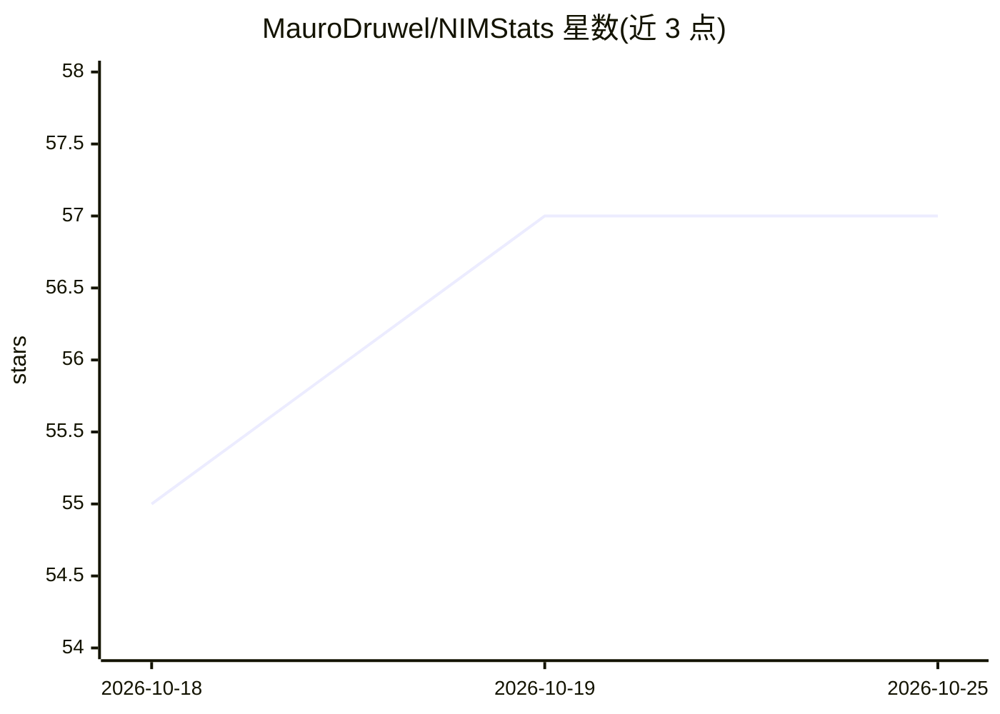

# MauroDruwel/NIMStats

⭐ 57 · JavaScript · 推送 2026-10-25 · [GitHub](https://github.com/MauroDruwel/NIMStats) · [官网](https://nimstats.maurodruwel.be) · 个人维护

**GitHub Actions 驱动的 NVIDIA NIM 模型每小时自动化基准与仪表盘**

通过 GitHub Actions 每小时对 22 个 NVIDIA NIM 上的模型（覆盖 11 家厂商）运行基准测试，测量响应时间、吞吐量与可用性，结果写入仓库内 SQLite 数据库，由静态站点（sql.js 浏览器端查询）生成交互式仪表盘。部署方式为 fork 仓库、配置 NIM_API_KEY 密钥并连接 Cloudflare Pages/GitHub Pages 等，无需自有服务器。另提供 /top 系列静态 API 端点，按加权评分输出各类别第一名模型，基准提示词、模型列表与调度频率均可自定义。

## 筛选速览

| 维度 | 判定 | 备注 |
|---|---|---|
| AI 角色 | `ai-ecosystem` | LLM/agent 周边工具 |
| 许可风险 | `permissive` | — |
| 部署形态 | `None` |  |
| 模型依赖 | — | README 未给出锁定关系 |
| 硬件要求 | — | 无带数字的原话,不猜 |
| 安装摩擦 | `low` | 无编译、无系统依赖或容器化 |
| 成熟度 | — | 结构信号不足 |

## 能力要点

- GitHub Actions 每小时自动运行，静态站点 + 免费 CI/CD，无服务器依赖
- 22 个模型 / 11 家厂商的响应时间、吞吐量与可用性基准
- Overview/Leaderboard/Explorer/Timeline/Compare 五个仪表盘标签页
- 公开 /top、/top/speed、/top/intelligence JSON 与纯文本 API 端点

## 适用场景

- 搭建自己的 NIM 模型性能监控仪表盘
- 按速度或综合评分查询当前表现最好的模型用于脚本集成
- 对比候选模型的历史响应时间与可靠性趋势

## 场景标签

`模型评测` · 领域:评测与运维

## 证据(README 行号)

> L10: > **Community-driven benchmarking of 22 NVIDIA NIM models — fully automated, zero infra cost, self-hostable in minu
> L16: NIMStats automatically benchmarks **22 NVIDIA NIM models** every hour using GitHub Actions and publishes the result

## 星数曲线

2026-10-18 55 → 2026-10-25 57（+2）

---
*卡片 v1 · prompt 1.4 · 生成 2026-10-24 · 置信度 high · 依据 README sha `cee27d3c943a` · [字段定义](../../DATASET.md)*
