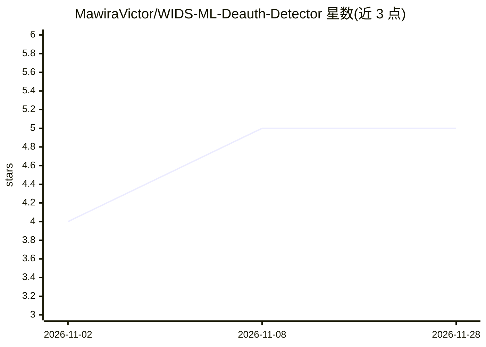

# MawiraVictor/WIDS-ML-Deauth-Detector

⭐ 5 · Python · 推送 2026-11-01 · [GitHub](https://github.com/MawiraVictor/WIDS-ML-Deauth-Detector) · 个人维护

**基于随机森林的 Wi-Fi 去认证攻击实时检测与阻断原型**

用 Python 与 scikit-learn 的随机森林分类器，基于 AWID3 公开数据集训练，实时评估 802.11 帧判别正常流量与 Deauthentication 洪水攻击；按 1 秒滚动窗口提取帧类型、信号强度、源帧率等行为特征，训练时用 GroupShuffleSplit 防止时间窗口泄漏。支持 CSV 离线回放（无需监听网卡）与 Linux 下监听模式的实时抓包（Scapy）；检测到恶意 MAC 后写入 blocklist.json 与 alerts.log。面向网络安全学习者与授权实验环境。

## 筛选速览

| 维度 | 判定 | 备注 |
|---|---|---|
| AI 角色 | `ai-native` | 本体是模型或模型工具 |
| 许可风险 | `none` | — |
| 部署形态 | `library` | 以包/库形式分发 |
| 模型依赖 | — | README 未给出锁定关系 |
| 硬件要求 | — | 无带数字的原话,不猜 |
| 安装摩擦 | `low` | 无编译、无系统依赖或容器化 |
| 成熟度 | — | 结构信号不足 |

## 能力要点

- 基于 AWID3 数据集训练的随机森林分类器（100 棵树，最大深度 12）
- 1 秒滚动窗口特征工程，含 deauth_ratio 等行为特征
- 回放模式无需监听网卡，live 模式用 Scapy 实时嗅探
- WIPS 组件将恶意 MAC 写入 blocklist.json 供防火墙消费

## 适用场景

- 在授权实验网络中检测 Wi-Fi 去认证洪水攻击
- 回放 AWID3 CSV 数据模拟攻击并测试阻断机制
- 训练并评估 802.11 入侵检测模型

## 场景标签

`网络安全` · 领域:学习与行业

## 证据(README 行号)

> L3: This project is a working prototype of a Machine Learning-based Wireless Intrusion Detection System (WIDS) with an o
> L5: The system is trained on the public AWID3 (Aegean Wi-Fi Intrusion Dataset) and evaluates 802.11 wireless frames in r

## 星数曲线

2026-11-02 4 → 2026-11-28 5（+1）

---
*卡片 v1 · prompt 1.4 · 生成 2026-11-21 · 置信度 high · 依据 README sha `0c6c17ef0193` · [字段定义](../../DATASET.md)*
