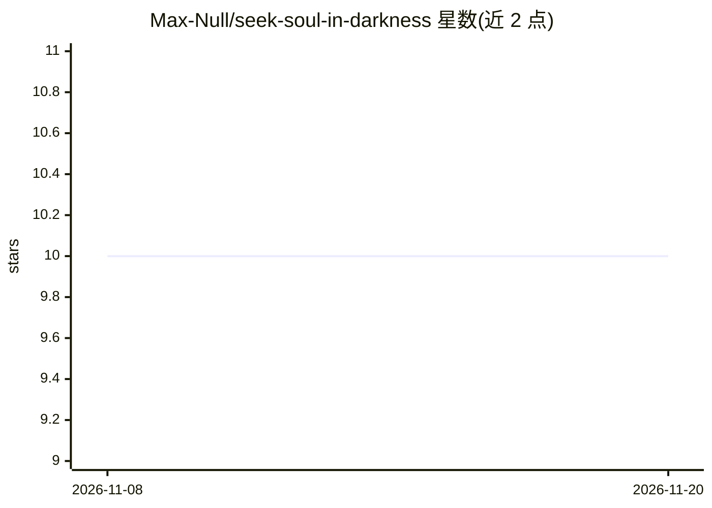

# Max-Null/seek-soul-in-darkness

⭐ 10 · TypeScript · MIT · 推送 2026-11-19 · [GitHub](https://github.com/Max-Null/seek-soul-in-darkness) · 个人维护 · 中文 README

**基于 DeepSeek DSH 的桌面 AI 应用：改壳装插件开箱即用**

SSiD（思灵）是在官方 DeepSeek Harness 桌面端底座上做 fork 改造的桌面 AI 应用：不改 DSH 源码，只改壳与插件两层。内核与 34 个随包插件（含 20 个自制）首启接入 profile，覆盖记忆与监督、中文思考与文风、侧栏生态、剧本杀、微信桥、CodeGraph MCP、Office/视频/Excel 面板等约 50 项功能。提供 Windows 与 macOS 安装包，开箱即用，无需装 Node/pnpm 或设置环境变量；支持与官方 DSH 桌面版共存；macOS 通道注明未在真机双击验证。

## 筛选速览

| 维度 | 判定 | 备注 |
|---|---|---|
| AI 角色 | `ai-native` | 本体是模型或模型工具 |
| 许可风险 | `permissive` | MIT |
| 部署形态 | `desktop` | 安装包/桌面程序 |
| 模型依赖 | locked-api |  |
| 硬件要求 | — | 无带数字的原话,不猜 |
| 安装摩擦 | `low` | 无编译、无系统依赖或容器化 |
| 成熟度 | — | 结构信号不足 |

## 能力要点

- 基于官方 DSH 桌面端底座 fork，只改壳与插件两层，跟随 DSH 版本迭代
- 随包 34 个插件 bundle（20 个自制），内核与插件随安装包分发
- 执行中遮罩：毛玻璃遮挡窗口内容并阻止睡眠/息屏，长按 2 秒或口令解除
- 与官方 DSH 桌面版同时运行，userData/存储根/协议隔离，跨会话记忆共用

## 适用场景

- 在 Windows/macOS 上开箱即用地运行基于 DeepSeek 的桌面 AI 助手
- 一个人玩 AI 当 DM 的剧本杀
- 挂机执行任务时用遮罩防止旁人读出窗口内容
- 通过微信桥等插件扩展桌面 AI 的使用场景

## 场景标签

`AI 助手` `聊天机器人` · 领域:对话与助手

## 证据(README 行号)

> L7: SSiD 是 fractal 的 **DSH 基座版**——基于 DeepSeek Harness 的桌面 AI 应用：在**官方 DSH 桌面端底座**上改壳、装插件，做成开箱即用的思灵。
> L38: |形态|**官方 DSH 桌面端底座的 fork**——内核随包进 `app.asar` 的 `dsh/`，Host 由官方的 `dsh-desktop-host` 担当，我们只做壳与插件这两层的改造|
> L79: - **开箱即用**：内核与预制插件**随包**（首启由壳把插件集接进 profile），不需要装 Node / pnpm、不需要设任何环境变量

## 星数曲线

2026-11-08 10 → 2026-11-20 10（+0）

---
*卡片 v1 · prompt 1.4 · 生成 2026-11-20 · 置信度 mid · 依据 README sha `ac9456b965fb` · [字段定义](../../DATASET.md)*
