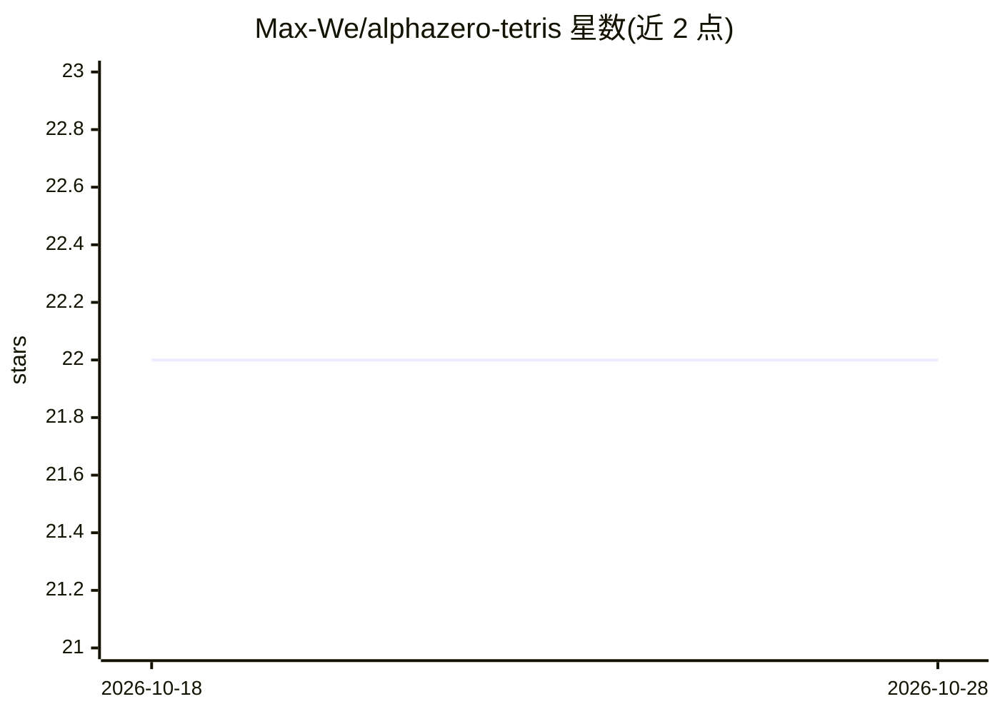

# Max-We/alphazero-tetris

⭐ 22 · Python · 推送 2026-07-07 · [GitHub](https://github.com/Max-We/alphazero-tetris) · [官网](https://max-we.github.io/alphazero-tetris/) · 个人维护

**用 AlphaZero+MCTS 从原始观测训练玩俄罗斯方块的强化学习实现**

基于 JAX 的 AlphaZero 算法在俄罗斯方块上的实现：不做动作空间压缩、不用手工特征，从原始观测训练 agent，蒙特卡洛树搜索的树策略可配置（PUCT/UCT/CLT/Thompson Sampling 等）。训练以 on-policy 顺序方式在单机 CPU 或 GPU 上进行，可用 poetry 安装依赖或使用 Dockerfile 运行，训练过程可同步到 W&B，并提供回放查看器与训练脚本。面向强化学习研究与实验者。

## 筛选速览

| 维度 | 判定 | 备注 |
|---|---|---|
| AI 角色 | `ai-native` | 本体是模型或模型工具 |
| 许可风险 | `none` | — |
| 部署形态 | `self-host` | docker 或自建部署 |
| 模型依赖 | — | README 未给出锁定关系 |
| 硬件要求 | — | 无带数字的原话,不猜 |
| 安装摩擦 | `low` | 无编译、无系统依赖或容器化 |
| 成熟度 | — | 结构信号不足 |

## 能力要点

- 从原始观测、完整动作空间训练 AlphaZero 玩俄罗斯方块
- MCTS 树策略可配置（PUCT/UCT/CLT/自定义）
- 支持单机 CPU 或 GPU 训练，on-policy 带缓冲区
- 提供 Dockerfile、W&B 同步与回放可视化 viewer

## 适用场景

- 研究 AlphaZero/MCTS 在大动作空间游戏上的表现
- 实验不同树策略、评估函数与损失函数
- 复现并可视化训练 agent 的对局回放

## 场景标签

`强化学习` · 领域:训练与推理

## 证据(README 行号)

> L6: This project makes no such assumptions and uses the AlphaZero algorithm
> L8: to use any tree policy for the Monte-Carlo Tree Search, like Thompson Sampling, UCB, or other custom policies for ex
> L9: script is designed in an on-policy & sequential way and an agent can be trained using a CPU or GPU on a single machi

## 星数曲线

2026-10-18 22 → 2026-10-28 22（+0）

---
*卡片 v1 · prompt 1.4 · 生成 2026-10-27 · 置信度 high · 依据 README sha `284140ff3ed7` · [字段定义](../../DATASET.md)*
