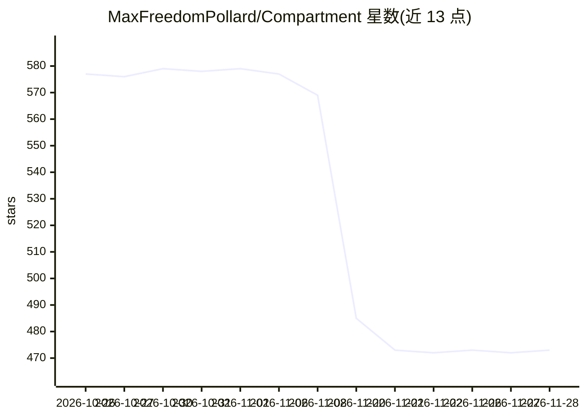

# MaxFreedomPollard/Compartment

⭐ 473 · Python · Apache-2.0 · 推送 2026-11-27 · [GitHub](https://github.com/MaxFreedomPollard/Compartment) · [官网](https://maxfreedompollard.github.io/Compartment/) · 个人维护

**给 AI agent 的加密离线本地记忆库，MCP 接入多客户端**

以 MCP 服务器形式为 AI agent 提供持久化记忆与文档保险库：数据存为本机单个加密文件，含嵌入向量，由口令解锁，运行时无网络与遥测。每条记忆为单条声明，记录来源、日期、可设过期；检索为内存索引上的向量+关键词混合搜索，嵌入由内置 384 维 int8 ONNX 模型本地运行，不含 LLM。支持事实累积与意见取代、标签后台维护、关系图存储及版本化加密文档。提供各系统托盘/面板 GUI，可通过一条命令接入 Claude Code、Claude Desktop 等多个 MCP 客户端。

## 筛选速览

| 维度 | 判定 | 备注 |
|---|---|---|
| AI 角色 | `ai-ecosystem` | LLM/agent 周边工具 |
| 许可风险 | `permissive` | Apache-2.0 |
| 部署形态 | `desktop` | 安装包/桌面程序 |
| 模型依赖 | — | README 未给出锁定关系 |
| 硬件要求 | — | 无带数字的原话,不猜 |
| 安装摩擦 | `low` | 无编译、无系统依赖或容器化 |
| 成熟度 | — | 结构信号不足 |

## 能力要点

- 加密离线：单加密文件含向量，无 API key、无账号、无网络与遥测
- 向量+关键词混合检索，内置 384 维 int8 ONNX 本地嵌入模型，无内部 LLM
- 记忆单声明强制、来源/日期必填、支持过期与意见取代
- 版本化加密文档存储（DMS），Markdown 边界分块并纳入混合检索

## 适用场景

- 让多个 agent 跨会话共享本机上的持久记忆
- 离线环境下运行完整 agent 而不泄露数据
- 把规格、合同等长文档加密保存并与原子记忆关联溯源

## 场景标签

`Agent 记忆` · 领域:Agent 开发

## 证据(README 行号)

> L33: Compartment is persistent memory for AI agents, stored on your own computer.
> L183: **No LLM inside.** Embeddings run locally with a bundled 384-dimension int8
> L5: OpenClaw, AntiGravity, Cursor, Codex and any other MCP client. No API key, no account, no

## 星数曲线

2026-10-26 577 → 2026-11-28 473（-104）

---
*卡片 v1 · prompt 1.4 · 生成 2026-11-28 · 置信度 mid · 依据 README sha `f000148995be` · [字段定义](../../DATASET.md)*
