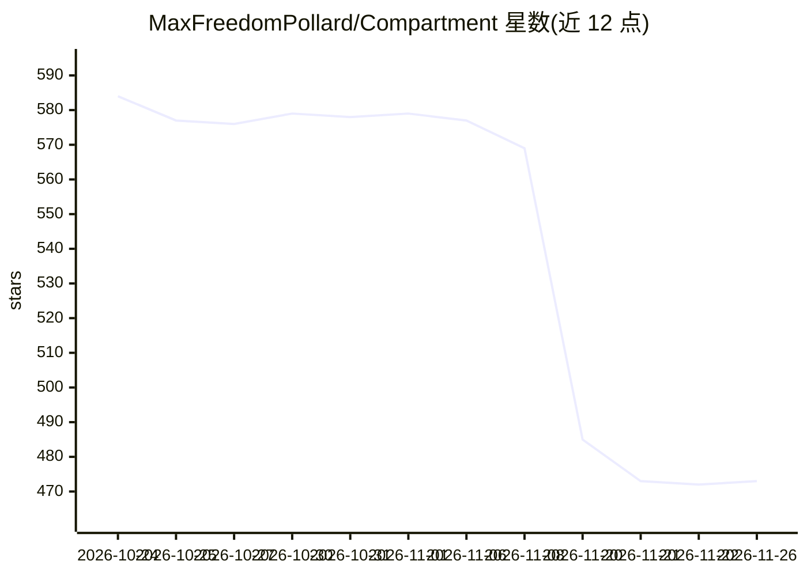

# MaxFreedomPollard/Compartment

⭐ 473 · Python · Apache-2.0 · 推送 2026-11-22 · [GitHub](https://github.com/MaxFreedomPollard/Compartment) · [官网](https://maxfreedompollard.github.io/Compartment/) · 个人维护

**为 AI agent 提供加密离线本地记忆库的 MCP 服务器**

在本地计算机上以单个加密文件保存 agent 记忆的 MCP 服务器：每条记忆为单条声明并记录来源与日期，支持过期、意见替换（supersedes）、图式关系存储与混合向量+关键词检索。内嵌 384 维 ONNX 嵌入模型，无 LLM 调用、无网络、无遥测。通过 compartment integrate 一条命令接入 Claude Code、Claude Desktop、Cursor、Codex 等多个 MCP 客户端，并带菜单栏/托盘 GUI 与浏览器仪表盘。需要 passphrase 解锁，记忆超 200 字符会被拒绝存储。

## 筛选速览

| 维度 | 判定 | 备注 |
|---|---|---|
| AI 角色 | `ai-ecosystem` | LLM/agent 周边工具 |
| 许可风险 | `permissive` | Apache-2.0 |
| 部署形态 | `desktop` | 安装包/桌面程序 |
| 模型依赖 | — | README 未给出锁定关系 |
| 硬件要求 | — | 无带数字的原话,不猜 |
| 安装摩擦 | `low` | 无编译、无系统依赖或容器化 |
| 成熟度 | — | 结构信号不足 |

## 能力要点

- 本地加密存储含嵌入向量，无 API key、无网络、无遥测
- 混合向量与关键词检索，固定重要度分层排序
- 每条记忆强制单声明（≤200 字符）并记录 source 与日期
- PostToolUse hook 使记忆捕获不依赖模型调用工具

## 适用场景

- 让 Claude Code 等编码 agent 在多个会话和项目间记住我的偏好与决定
- 在不联网、不注册账号的前提下保存 agent 学到的事实
- 管理会过期的临时记忆（如门禁码、预订信息）
- 用仪表盘查看 agent 记忆的增长与关系图

## 场景标签

`Agent 记忆` · 领域:Agent 开发

## 证据(README 行号)

> L3: **Encrypted, fully offline memory for AI agents.** One vault on your own
> L33: Compartment is persistent memory for AI agents, stored on your own computer.
> L167: **No LLM inside.** Embeddings run locally with a bundled 384-dimension int8

## 星数曲线

2026-10-24 584 → 2026-11-26 473（-111）

---
*卡片 v1 · prompt 1.4 · 生成 2026-11-25 · 置信度 mid · 依据 README sha `15d06d7021eb` · [字段定义](../../DATASET.md)*
