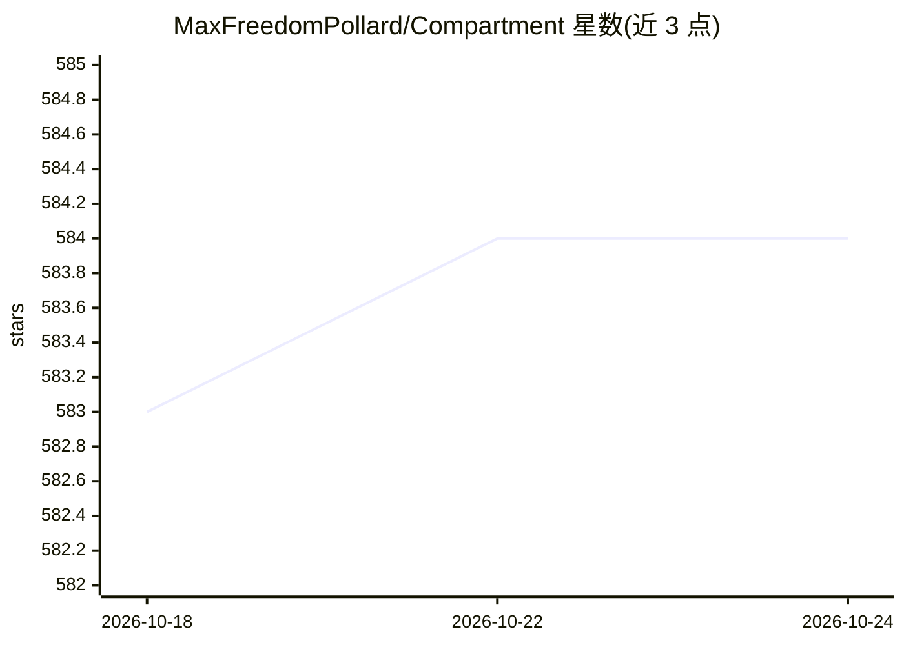

# MaxFreedomPollard/Compartment

⭐ 584 · Python · Apache-2.0 · 推送 2026-10-20 · [GitHub](https://github.com/MaxFreedomPollard/Compartment) · [官网](https://maxfreedompollard.github.io/Compartment/) · 个人维护

**给 AI agent 的本地加密持久记忆库（MCP server）**

面向 Claude Code、Claude Desktop、Cursor、Codex 等 MCP 客户端的持久记忆服务：单条声明式记忆（≤200 字符）记录来源与日期，支持过期、意见更新（supersedes）、关系图与混合向量+关键词检索（约 12 ms）。磁盘数据全部加密（含向量），口令解锁；内置 384 维 int8 ONNX 嵌入模型本地运行，无 LLM、无网络、无遥测，附带 6,700 条参考事实。提供菜单栏/通知区面板与浏览器仪表盘（127.0.0.1 只读），CLI 一条命令接入各 agent，PyPI 分发。

## 筛选速览

| 维度 | 判定 | 备注 |
|---|---|---|
| AI 角色 | `ai-ecosystem` | LLM/agent 周边工具 |
| 许可风险 | `permissive` | Apache-2.0 |
| 部署形态 | `desktop` | 安装包/桌面程序 |
| 模型依赖 | — | README 未给出锁定关系 |
| 硬件要求 | — | 无带数字的原话,不猜 |
| 安装摩擦 | `low` | 无编译、无系统依赖或容器化 |
| 成熟度 | — | 结构信号不足 |

## 能力要点

- 单条声明式记忆，强制 ≤200 字符并记录来源与日期，支持过期与意见替换
- 磁盘全加密（含嵌入向量），口令解锁，无网络无遥测
- 内置 384 维 int8 ONNX 嵌入模型本地运行，无 LLM 依赖
- 提供 macOS/Windows/Linux 面板与只读浏览器仪表盘（记忆地图、关系图）

## 适用场景

- 让多个 AI agent 在本机共享跨会话、跨项目的长期记忆
- 对数据不出本机有要求的本地记忆存储与检索
- 查看和审计 agent 学到的记忆（recent/status/dashboard）

## 场景标签

`Agent 记忆` · 领域:Agent 开发

## 证据(README 行号)

> L3: **Encrypted, fully offline memory for AI agents.** One vault on your own
> L5: OpenClaw, Cursor, Codex and any other MCP client. No API key, no account, no
> L32: Compartment is persistent memory for AI agents, stored on your own computer.

## 星数曲线

2026-10-18 583 → 2026-10-24 584（+1）

---
*卡片 v1 · prompt 1.4 · 生成 2026-10-21 · 置信度 mid · 依据 README sha `846525fab820` · [字段定义](../../DATASET.md)*
