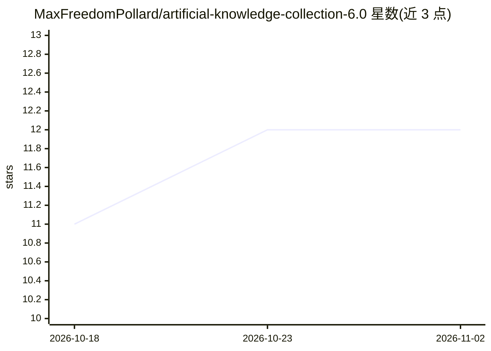

# MaxFreedomPollard/artificial-knowledge-collection-6.0

⭐ 12 · Python · NOASSERTION · 推送 2026-08-01 · [GitHub](https://github.com/MaxFreedomPollard/artificial-knowledge-collection-6.0) · 个人维护

**面向 AI 的九个人工知识数据集合集，对齐为 54 万节点图谱并附推理基准**

由个人维护者整理的知识数据集合集：收录 Cyc 常识库（159,722 条手工概念，宣称唯一未损坏副本）、WordNet、ConceptNet 人工核心、CODATA 物理常数、元素/恒星/行星等天体与化学数据、CIA World Factbook 地理数据、人类词规范等九个数据集，每个清洗为单文件并附带来源与清洗记录（FORMATION.md）。核心交付为对齐合并的 What Exists List（544,279 节点、1,003,336 关联），另含 11,250 题可证明的推理基准 AKC-Eval。提供 JSONL/Parquet/纯文本/embed 就绪等多种格式，通过 release 下载并附 SHA256 校验。

## 筛选速览

| 维度 | 判定 | 备注 |
|---|---|---|
| AI 角色 | `ai-knowledge` | 知识聚合/清单类 |
| 许可风险 | `none` | NOASSERTION |
| 部署形态 | `None` |  |
| 模型依赖 | — | README 未给出锁定关系 |
| 硬件要求 | — | 无带数字的原话,不猜 |
| 安装摩擦 | `low` | 无编译、无系统依赖或容器化 |
| 成熟度 | `idea` | |

## 能力要点

- 九个数据集对齐为 544,279 节点、1,003,336 关联的单一图谱（What Exists List）
- Cyc 手写常识库的清洁副本（159,722 概念），非机器生成文本
- AKC-Eval：11,250 道答案可由知识自身证明的推理测试题
- 每个数据集带 KEY.md 字段说明与 FORMATION.md 来源/清洗记录，release 附 SHA256 校验

## 适用场景

- 为模型训练或 RAG 检索提供人工核验的常识与事实数据
- 用 AKC-Eval 基于人类核验事实评估模型推理能力
- 获取 WordNet/ConceptNet 核心/CODATA 等数据集的清洗单文件版本

## 场景标签

`知识图谱` `模型评测` · 领域:评测与运维

## 证据(README 行号)

> L16: **The What Exists List** (`what-exists-list/`). The merged master file, and the one thing here you will find nowher
> L32: **AKC-Eval** (`akc-eval/`). 11,250 yes or no reasoning questions whose every answer is provable from the knowledge 

## 星数曲线

2026-10-18 11 → 2026-11-02 12（+1）

---
*卡片 v1 · prompt 1.4 · 生成 2026-11-01 · 置信度 high · 依据 README sha `6518a6b1c47c` · [字段定义](../../DATASET.md)*
