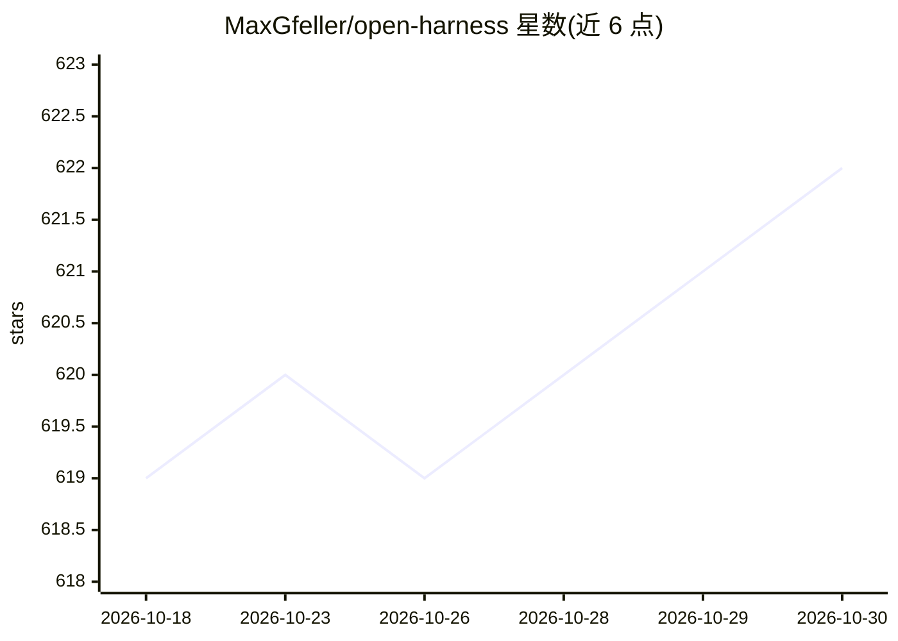

# MaxGfeller/open-harness

⭐ 622 · TypeScript · MIT · 推送 2026-07-17 · [GitHub](https://github.com/MaxGfeller/open-harness) · [官网](https://open-harness.dev) · 个人维护

**用代码构建通用 AI agent 的组合式 TypeScript SDK**

基于 Vercel AI SDK 的 code-first agent 构建框架，受 Claude Code、Codex 等 agent harness 启发。提供 Agent、Session（多轮对话、上下文窗口、压缩、重试、持久化）、可组合中间件（Conversation API）、文件系统与 bash 工具、子代理（动态目录、可恢复会话、后台运行）、MCP 集成与 React/Vue 流式 UI 钩子等包。附带 CLI、Next.js、Nuxt 示例，默认使用 OpenAI API key，CLI 示例可改用 ChatGPT/Codex OAuth。面向在代码中搭建 agent 应用的开发者。

## 筛选速览

| 维度 | 判定 | 备注 |
|---|---|---|
| AI 角色 | `ai-ecosystem` | LLM/agent 周边工具 |
| 许可风险 | `permissive` | MIT |
| 部署形态 | `library` | 以包/库形式分发 |
| 模型依赖 | — | README 未给出锁定关系 |
| 硬件要求 | — | 无带数字的原话,不猜 |
| 安装摩擦 | `low` | 无编译、无系统依赖或容器化 |
| 成熟度 | `idea` | |

## 能力要点

- Agent/Session/Conversation 组合式中间件架构
- 子代理支持动态目录、可恢复会话与后台运行
- 文件系统/bash 工具与 MCP Server 集成
- React 与 Vue 流式聊天 UI 包

## 适用场景

- 在 TypeScript 项目中编写带工具调用的 agent
- 搭建带会话压缩、重试与持久化的多轮 agent
- 构建带子代理委派的 CLI 或 Web 聊天应用

## 场景标签

`Agent 框架` · 领域:Agent 开发

## 证据(README 行号)

> L9: Build capable, general-purpose AI agents in code. Based on Vercel's AI SDK, inspired by Claude Code, Codex, and simi
> L17: |`@openharness/core`|Agent, Session, Conversation, middleware, tools, UI stream integration|
> L26: npm install @openharness/core @ai-sdk/openai

## 星数曲线

2026-10-18 619 → 2026-10-30 622（+3）

---
*卡片 v1 · prompt 1.4 · 生成 2026-10-21 · 置信度 high · 依据 README sha `cbe68a511157` · [字段定义](../../DATASET.md)*
