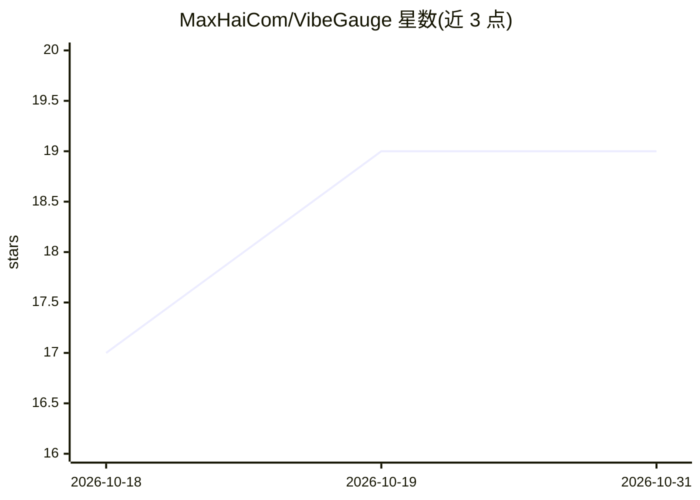

# MaxHaiCom/VibeGauge

⭐ 19 · Swift · MIT · 推送 2026-09-24 · [GitHub](https://github.com/MaxHaiCom/VibeGauge) · 个人维护 · 中文 README

**macOS 菜单栏仪表盘：监控 AI 编码工具配额与用量**

原生 Swift + AppKit + SwiftUI 编写的 macOS 菜单栏应用，面向使用 Claude Code、Codex、Gemini/Antigravity、Grok CLI 等自主编码代理的开发者。从本地会话日志或厂商缓存文件读取订阅档位、配额与重置倒计时，提供考虑用户睡眠时间的周配额预测、Token 与 Prompt Cache 命中统计、AI 出口 IP 与 DNS 泄漏检测、一键清理孤儿 MCP 进程，以及可选的本地 API key 代理。零第三方依赖，分析数据留在本地，不上传提示词或用量日志；要求 macOS 14+。

## 筛选速览

| 维度 | 判定 | 备注 |
|---|---|---|
| AI 角色 | `ai-ecosystem` | LLM/agent 周边工具 |
| 许可风险 | `permissive` | MIT |
| 部署形态 | `desktop` | 安装包/桌面程序 |
| 模型依赖 | local-ok | 支持本地模型 |
| 硬件要求 | — | 无带数字的原话,不猜 |
| 安装摩擦 | `low` | 无编译、无系统依赖或容器化 |
| 成熟度 | — | 结构信号不足 |

## 能力要点

- 读取 Claude / Codex / Gemini / Grok / Kimi 及 Coding Plan（火山引擎/阿里/GLM 等）的配额与重置时间
- 基于本机 CLI 日志、感知用户作息的周配额预测
- Token 日统计与 Prompt Cache 命中率、月历视图与 API 等效成本
- 一键识别并清理孤儿 MCP 进程，可选每 30 分钟后台清扫

## 适用场景

- 在菜单栏随时查看各 AI 编码工具的剩余配额和重置倒计时
- 排查 Prompt Cache 命中率与每日 Token 消耗、API 等效成本
- 清理编码代理遗留的 MCP 僵尸进程释放内存
- 监测 AI 服务的出口 IP 是否符合预期、是否存在 DNS 泄漏

## 场景标签

 · 领域:开发者工具/AI 编码监控

## 证据(README 行号)

> L7:  Claude / Codex / Gemini / Grok quotas with sleep-aware forecasts · AI egress IP & DNS-leak checks · Token & Prompt 
> L31: When using autonomous coding agents like **Claude Code**, **OpenAI Codex**, **Google Antigravity (agy)**, or **Grok
> L40: **VibeGauge** is built entirely with native **Swift + AppKit + SwiftUI**. It has **zero third-party dependencies an

## 星数曲线

2026-10-18 17 → 2026-10-31 19（+2）

---
*卡片 v1 · prompt 1.4 · 生成 2026-10-29 · 置信度 high · 依据 README sha `5be53be96a22` · [字段定义](../../DATASET.md)*
