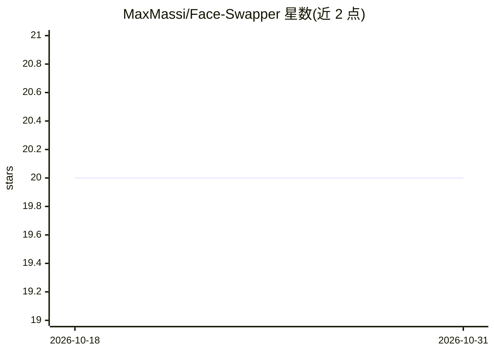

# MaxMassi/Face-Swapper

⭐ 20 · Python · 推送 2026-10-12 · [GitHub](https://github.com/MaxMassi/Face-Swapper) · 个人维护

**自动生成换脸图像数据集，用于训练换脸检测模型**

Python 项目，基于 insightface 库的 Inswapper 模型自动生成 100 张换脸图像，按 similar/dissimilar/random/processed 四类策略选择人脸，构建用于训练换脸检测分类器的多样化数据集。用户通过命令行指定类别运行，输出保存到 data/ 目录，仓库另含预训练模型目录。安装方式为 git clone 与 pip 安装 zip 包；README 中多处文件路径均指向同一 zip 链接。

## 筛选速览

| 维度 | 判定 | 备注 |
|---|---|---|
| AI 角色 | `ai-native` | 本体是模型或模型工具 |
| 许可风险 | `none` | — |
| 部署形态 | `library` | 以包/库形式分发 |
| 模型依赖 | — | README 未给出锁定关系 |
| 硬件要求 | — | 无带数字的原话,不猜 |
| 安装摩擦 | `low` | 无编译、无系统依赖或容器化 |
| 成熟度 | — | 结构信号不足 |

## 能力要点

- 基于 insightface Inswapper 模型自动生成换脸图像
- 四类人脸选择策略（similar/dissimilar/random/processed）
- 面向换脸检测分类器训练的数据集构建
- 命令行按类别批量生成并保存到输出目录

## 适用场景

- 为换脸检测模型构建训练数据集
- 按人脸相似度分类批量生成换脸样本

## 场景标签

`图像生成` · 领域:内容生成

## 证据(README 行号)

> L7: Face Swapper is a Python project designed to automate the creation of 100 curated face-swaps. This project strategic
> L9: Utilizing the insightface library's Inswapper model, Face Swapper provides a straightforward way to generate and man

## 星数曲线

2026-10-18 20 → 2026-10-31 20（+0）

---
*卡片 v1 · prompt 1.4 · 生成 2026-10-28 · 置信度 high · 依据 README sha `58aa90ecd463` · [字段定义](../../DATASET.md)*
