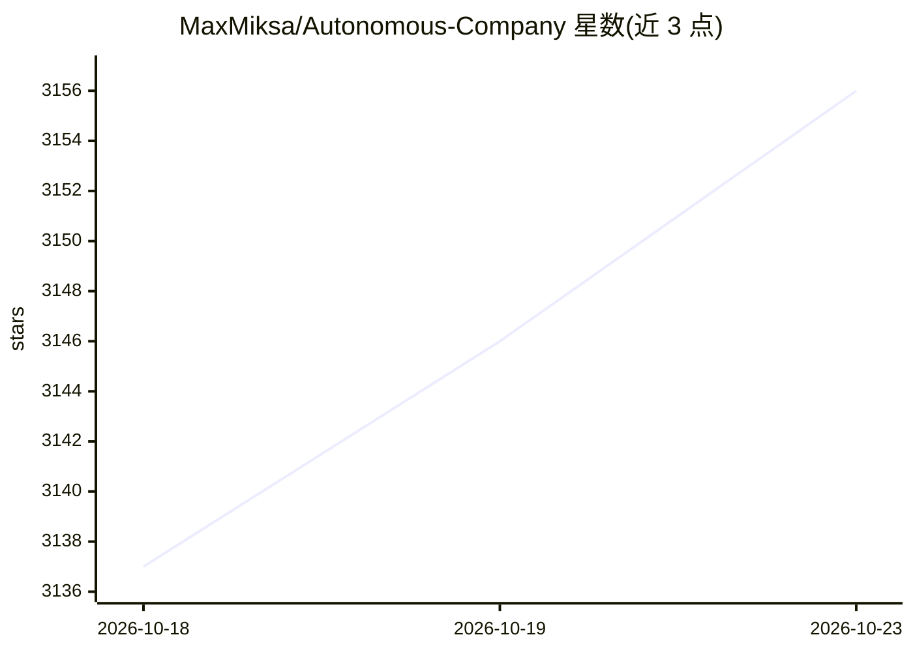

# MaxMiksa/Autonomous-Company

⭐ 3,156 · Python · MIT · 推送 2026-10-21 · [GitHub](https://github.com/MaxMiksa/Autonomous-Company) · 个人维护 · 中文 README

**在本机持续自主运转的多 Agent 'AI 公司'框架，含 14 个角色**

面向希望 AI 团队在本地持续工作的个人开发者：以 Claude Code（默认）或 Codex CLI 为引擎，通过 auto-loop 脚本循环读取共享工作摘要（consensus.md）、决策、组建 2-5 人团队、执行并更新摘要，由 launchd/systemd 守护进程自动重启。提供 14 个基于专家人设的角色定义、30+ 可复用技能、本地 Product Center 仪表盘（最多四项目并行）。运行需人类配置目标、权限与预算，持续运行依赖外部服务与模型可用性；支持 macOS 与 Windows/WSL。

## 筛选速览

| 维度 | 判定 | 备注 |
|---|---|---|
| AI 角色 | `ai-native` | 本体是模型或模型工具 |
| 许可风险 | `permissive` | MIT |
| 部署形态 | `None` |  |
| 模型依赖 | — | README 未给出锁定关系 |
| 硬件要求 | — | 无带数字的原话,不猜 |
| 安装摩擦 | `medium` | 含编译或系统依赖之一 |
| 成熟度 | — | 结构信号不足 |

## 能力要点

- 循环式自主工作流：读摘要→决策→组队→执行→更新摘要，守护进程崩溃自重启
- 14 个专家人设角色定义与 30+ 可复用技能
- 本地 Product Center：产品目录、只读导入、并行工作（默认 4 项目）
- 文件式人类干预：编辑 consensus.md 的 Next Action/Human Overrides 引导方向

## 适用场景

- 让 AI 团队在本地按预算与权限边界持续做研究、决策和写码
- 并行管理与审查多个 AI 生成的产品/项目
- 通过本地仪表盘监控工作循环、用量与日志

## 场景标签

`多智能体` `Agent 框架` · 领域:Agent 开发

## 证据(README 行号)

> L7: Powered by **Agentic Workflows**, this project provides 14 **AI agent role definitions**, each drawing on an expert'
> L10: Powered by Claude Code (default) and Codex CLI on macOS + Windows/WSL, with a local dashboard on both hosts.
> L41: You start a loop. Each cycle reads the shared work summary, decides what to do, forms a team as needed, executes, u

## 星数曲线

2026-10-18 3,137 → 2026-10-23 3,156（+19）

---
*卡片 v1 · prompt 1.4 · 生成 2026-10-20 · 置信度 mid · 依据 README sha `3c711112da75` · [字段定义](../../DATASET.md)*
