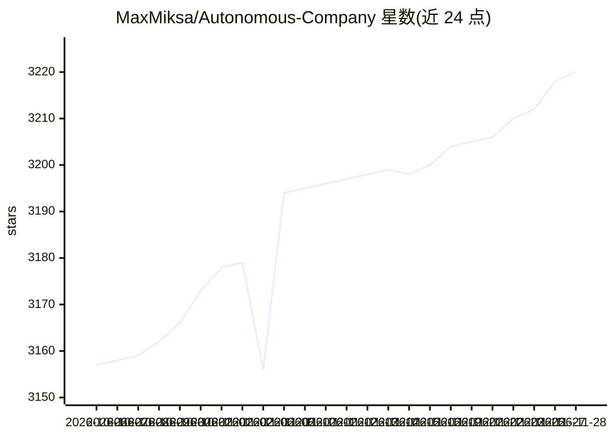

# MaxMiksa/Autonomous-Company

⭐ 3,220 · Python · MIT · 推送 2026-11-27 · [GitHub](https://github.com/MaxMiksa/Autonomous-Company) · 个人维护 · 中文 README

**在本机持续自主运行的 14 角色 AI 公司框架**

基于 Agentic Workflows 的多智能体框架，定义 14 个借鉴真实专家（如 DHH、Kelsey Hightower）思路的角色，用户配置目标、权限与预算后，循环守护进程按周期读取共识摘要、组建团队并执行研究、决策与编码工作。默认通过 Claude Code / Codex CLI 驱动，可选 Cursor 与 OpenAI 兼容适配器，需显式配置。本地提供产品中心 Dashboard 与基于 consensus.md 文件的人工干预机制。持续运行依赖所配置的服务与模型可用性。

## 筛选速览

| 维度 | 判定 | 备注 |
|---|---|---|
| AI 角色 | `ai-ecosystem` | LLM/agent 周边工具 |
| 许可风险 | `permissive` | MIT |
| 部署形态 | `None` |  |
| 模型依赖 | — | README 未给出锁定关系 |
| 硬件要求 | — | 无带数字的原话,不猜 |
| 安装摩擦 | `medium` | 含编译或系统依赖之一 |
| 成熟度 | — | 结构信号不足 |

## 能力要点

- 14 个专家人格角色定义与 30+ 可复用技能
- 守护进程循环：每周期读取 consensus.md 并按预算/权限执行
- 本地产品中心 Dashboard，默认最多 4 个项目并行
- 文件式人工干预（File-based Steering）与用量/预算治理

## 适用场景

- 在我的电脑上让多角色 agent 团队按设定目标持续工作
- 用本地 Dashboard 管理多个并行 agent 项目与预算
- 通过编辑 consensus.md 指导下一周期任务

## 场景标签

`多智能体` `Agent 框架` · 领域:Agent 开发

## 证据(README 行号)

> L7: Powered by **Agentic Workflows**, this project provides 14 **AI agent role definitions**, each drawing on an expert'
> L10: Powered by Claude Code (default) and Codex CLI on macOS + Windows/WSL, with a local dashboard on both hosts.
> L193: Autonomous-Company is not a simple LLM API wrapper, but a highly decoupled **Multi-Agent System (MAS)**. Its techn

## 星数曲线

2026-10-26 3,157 → 2026-11-28 3,220（+63）

---
*卡片 v1 · prompt 1.4 · 生成 2026-11-28 · 置信度 high · 依据 README sha `6dae93ac0c50` · [字段定义](../../DATASET.md)*
