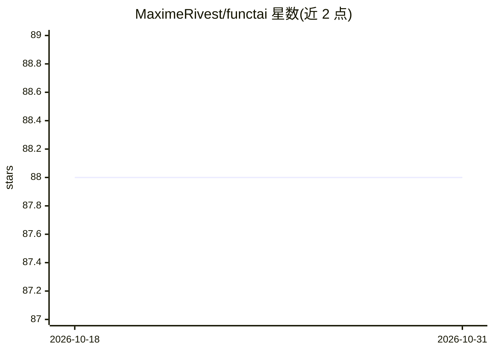

# MaximeRivest/functai

⭐ 88 · Python · MIT · 推送 2026-10-10 · [GitHub](https://github.com/MaximeRivest/functai) · [官网](https://maximerivest.github.io/functai/) · 个人维护

**让 LLM 按函数签名与类型生成函数体的多语言库（Python/TS/R/Julia）**

functai 把带类型签名的函数转换为对语言模型的调用：函数名、描述与类型表达意图，返回值即所声明的类型；可在整张表上批量运行该函数，用 evaluate 统计准确率（如 exact_match 及置信区间），进而迭代优化。同一函数在 Python、TypeScript、R、Julia 四种语言中版本一致，跨语言可加载与评分。Python 包已发布到 PyPI（1.2.0），TypeScript、R、Julia 尚未发布到各自包管理平台，需从源码安装。MIT 许可。

## 筛选速览

| 维度 | 判定 | 备注 |
|---|---|---|
| AI 角色 | `ai-ecosystem` | LLM/agent 周边工具 |
| 许可风险 | `permissive` | MIT |
| 部署形态 | `library` | 以包/库形式分发 |
| 模型依赖 | — | README 未给出锁定关系 |
| 硬件要求 | — | 无带数字的原话,不猜 |
| 安装摩擦 | `low` | 无编译、无系统依赖或容器化 |
| 成熟度 | `idea` | |

## 能力要点

- 装饰器/公式语法定义 LLM 函数，输出为声明的类型
- 整表批量运行并用 evaluate 测量准确率（exact_match 与置信区间）
- 四种语言共享同一契约：版本一致、跨语言加载与评分
- 内置契约检查命令，四种实现互相对照验证

## 适用场景

- 对数据表批量做 LLM 分类/抽取任务并量化其准确率
- 跨语言团队用同一函数定义在各自语言中调用与评测
- 通过测量结果迭代改进提示与函数设计

## 场景标签

`模型评测` `提示工程` · 领域:Agent 开发

## 证据(README 行号)

> L6: functai turns a typed function into a call to a language model. The
> L8: back as the type you asked for. Then you run it on a whole table, find out
> L24: evaluate(team, tickets, expected = category)                      # exact_match: 0.96 (95% interval 0.90 to 0.99)

## 星数曲线

2026-10-18 88 → 2026-10-31 88（+0）

---
*卡片 v1 · prompt 1.4 · 生成 2026-10-23 · 置信度 high · 依据 README sha `9064436212fd` · [字段定义](../../DATASET.md)*
