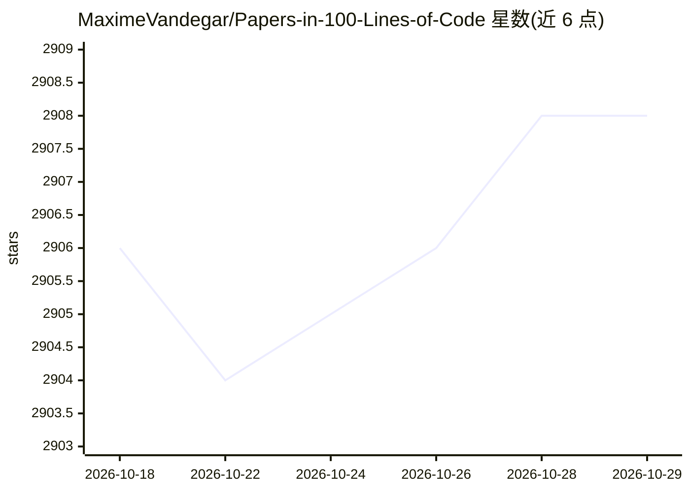

# MaximeVandegar/Papers-in-100-Lines-of-Code

⭐ 2,908 · Python · MIT · 推送 2026-10-22 · [GitHub](https://github.com/MaximeVandegar/Papers-in-100-Lines-of-Code) · 个人维护

**用约百行代码复现经典深度学习论文的代码合集**

收录深度学习论文极简实现的代码仓库：每篇论文配一段约 100 行的实现代码，条目覆盖 GAN 系列（原始 GAN、WGAN、DCGAN、CycleGAN）、扩散模型（DDPM、DDIM）、神经辐射场（NeRF、pixelNeRF、FastNeRF、KiloNeRF、PlenOctrees）、归一化与优化器（Adam、RAdam、RMSNorm、GELU）、元学习（MAML、Reptile）等方向。README 以论文列表形式组织，每条给出标题、arXiv/PMLR/Nature/OpenReview 链接、作者与日期，供学习论文原理与阅读精简参考实现使用。

## 筛选速览

| 维度 | 判定 | 备注 |
|---|---|---|
| AI 角色 | `ai-knowledge` | 知识聚合/清单类 |
| 许可风险 | `permissive` | MIT |
| 部署形态 | `None` |  |
| 模型依赖 | — | README 未给出锁定关系 |
| 硬件要求 | — | 无带数字的原话,不猜 |
| 安装摩擦 | `low` | 无编译、无系统依赖或容器化 |
| 成熟度 | — | 结构信号不足 |

## 能力要点

- 每篇论文配约 100 行代码的极简实现
- 条目附论文原文链接、作者与发表日期
- 覆盖 GAN、扩散模型、NeRF、元学习等多个方向
- 声明接受社区贡献

## 适用场景

- 学习经典深度学习论文的精简实现
- 教学或自学时对照论文理解算法结构
- 查找 GAN、扩散模型、神经渲染等方向的入门代码

## 场景标签

`教程课程` · 领域:学习与行业

## 证据(README 行号)

> L5: # Papers in 100 Lines of Code
> L7: Implementation of papers in 100 lines of code.

## 星数曲线

2026-10-18 2,906 → 2026-10-29 2,908（+2）

---
*卡片 v1 · prompt 1.4 · 生成 2026-10-21 · 置信度 high · 依据 README sha `41901ee0df6e` · [字段定义](../../DATASET.md)*
